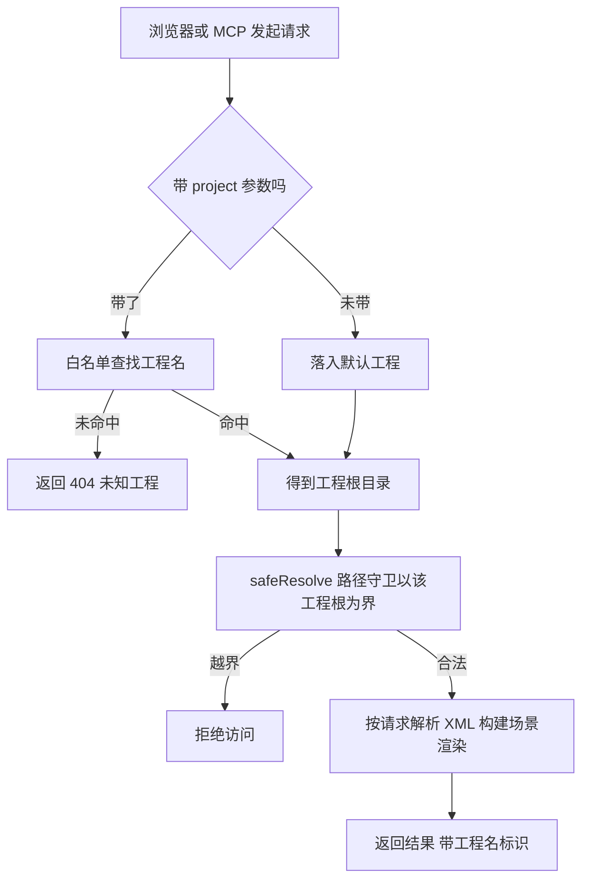

# FairyGUI 多工程切换设计方案

> 日期：2026-11-09
> 状态：方案分析（未实施）
> 背景：当前工作区已从 CC-Default（官方 Demo）手工替换为 fgui_game_42324（玄物麻将），替换动作是 mv 目录 + 重启进程。本方案分析"支持切换 FairyGUI 工程"的正确做法。

## 1. 现状：root 是三处硬绑定 + 前端零工程概念

| 绑定点 | 位置 | 形态 |
|---|---|---|
| 服务启动 | src/server/main.ts | `process.env.FGUI_PROJECT_ROOT ?? "CC-Default"` 启动时定死，传 `createApp({rootDir})` |
| 服务路由 | src/server/server.ts | `createApp` 闭包持有 root/assetsRoot，全部路由共用；safeResolve(root, rel) 路径守卫以它为界 |
| MCP | src/mcp/main.ts | `ctx = {rootDir: root}`，9 个工具全走 ctx.rootDir |
| 前端工作台 | src/editor/* | **无工程概念**。唯一工程信号是 `/api/project` 返回的 `root` 字段（顶栏 tb-project 显示用）；包树/画布/Inspector 全部只按"当前服务端唯一工程"假设工作 |

换工程现状 = `mv 目录 + 重启进程`（本次刚手工做过一遍）。能用，但：切换慢（重启）、不能对比着看两个工程、MCP 侧同样要改环境变量重启。

**有利事实（决定了切换可以做得很轻）**：

- 解析器（component-parser / package-parser）**零缓存**：无模块级 Map，getComponent 每次可 fresh；ui-asset-index 每请求重建（943ms 量级）。多工程按请求切换**没有缓存串扰问题**——这是本方案最大的可行性支点。
- 路径守卫 safeResolve(root, rel) 以参数形式收 root，只要每请求传入对应工程根，守卫语义自动生效。
- 组件寻址（`Basics/components/Button.xml` 相对路径）都是 assets 下相对路径，工程名作为新的最外层前缀叠加即可，不必改寻址语义。

## 2. 方案对比

### 方案 A：启动参数切换（重启级）

环境变量/CLI 参数选工程：`FGUI_PROJECT_ROOT=projects/xxx npm run serve`。

- 优点：零改动（现状规范化），把 projects/ 目录约定写进 README 即可。
- 缺点：切换 = 重启；浏览器多标签同时看两个工程做不到；工作台顶栏无切换入口，非开发人员不会用环境变量。
- 适用：只有开发者自己用、且极少切换。

### 方案 B：工程注册目录 + 请求级 project 参数（推荐）

`projects/` 目录下每个子目录是一个工程（含 assets/ 即算）；API 全部路由加可选 `?project=`；工作台顶栏加工程切换下拉。

- 优点：不重启切换；多标签可各看各的工程（project 是 URL 参数不是服务状态）；改动集中且小（见第 3 节）。
- 缺点：所有 API 调用点多一个参数要传（前端 fetch 封装一处解决）；MCP 工具签名要加可选参数。
- 适用：当前真实需求（官方 Demo 和麻将工程来回对比测试）。

### 方案 C：URL 前缀路由 /p/{project}/...

每工程一个路径前缀，REST 更纯粹。

- 优点：URL 即工程标识，缓存/分享友好。
- 缺点：所有路由表和前端 URL 拼接全改，`/view` iframe 与 postMessage 协议也要跟着动；收益与改动不成比例。
- 结论：不选。`?project=` 查询参数已满足需求（iframe src 带 query 天然支持）。

**推荐：方案 B，分两期**（第 5 节）。

## 3. 方案 B 设计

### 3.1 工程注册与发现

```
projects/                     # 工程注册目录（约定：子目录含 assets 即一个工程）
  CC-Default/                 #   官方 Demo（现 CC-Default-orig 迁入）
  fgui_game_42324/            #   玄物麻将
  xxx/
```

- `listProjects(baseDir)`：枚举 projects/ 直接子目录，含 assets/ 的记为工程；目录名即工程名（kebab/字母数字，天然做白名单）。
- **向后兼容形态**：projects/ 不存在时回退现状——`FGUI_PROJECT_ROOT` 环境变量（或默认 CC-Default）作为唯一工程，`?project=` 参数被忽略或映射到该唯一工程。现有测试（fixtures 工作区就是单工程形态）零改动。
- 默认工程：projects/ 存在时取列表第一个（或配置 default）；`?project=` 缺省一律落到默认工程，保证旧链接/旧脚本不破。

### 3.2 服务端：root 从常量变工厂

```ts
// 现状（server.ts）
const root = path.resolve(opts.rootDir);          // createApp 闭包定死
// 方案 B
function projectRoot(name: string | null): string | null {
  // 白名单校验：name 必须命中 listProjects() 结果；null → 默认工程
  // 防路径注入：绝不拼接未校验的 name
}
// route() 内每请求：
const root = projectRoot(u.searchParams.get("project"));
if (!root) return json(res, 404, { error: "未知工程: xxx" });
const assetsRoot = path.join(root, "assets");
// 其余逻辑不变——safeResolve/buildScene/loadPackage 全部已按参数收 root
```

改动面：`route(req, res)` 的 root/assetsRoot 两个参数从闭包常量改为每请求解析；其余（safeResolve、findPackageDir、buildScene、渲染、diff、xml-write）**零改动**——它们本来就只依赖传入的 root。

新增一个路由：`GET /api/projects` → `[{name, packageCount}]`（顶栏切换器数据源）。

`/api/project` 响应增加 `project` 字段（当前工程名），前端顶栏显示改用它。

### 3.3 前端工作台：顶栏工程切换器

- 顶栏加下拉（`/api/projects` 驱动），当前工程显示在原 tb-project 位置。
- 选择工程 = `localStorage.setItem("fgui.project", name)` + 重载页面数据（包树/画布/rel-bar 全部重新拉取，ED Store 清空——切换语义就是"打开另一个工程"，不做跨工程状态保留）。
- 所有 fetch 与 iframe src 统一追加 `?project=${current}`：editor 五模块现共 5 处直接 `fetch(` 调用，无统一封装——先在 editor-page.ts 加一个 `api(url)` 助手集中拼接（一处改动收敛五处），避免参数字符串散落。
- 刷新/重开浏览器记住上次工程（localStorage）。

### 3.4 MCP

- 新增工具 `list_projects`（枚举工程）。
- 其余 9 个工具加可选 `project` 参数（缺省默认工程），ctx 从"单一 rootDir"变为"projectRoot(name) 解析"。
- 工具描述里写明：组件相对路径都是相对所选工程的 assets/。

### 3.5 安全与边界

- 工程名白名单 = projects/ 目录名枚举结果；请求带未知 project → 404（不猜、不回退静默）。
- safeResolve 每请求以对应工程根为界，跨工程路径访问在守卫层天然被拒。
- 路径注入：project 参数不参与任何路径拼接，只做 Map 查找（name → root）。

### 3.6 不做（明示边界）

- 跨工程场景 diff（a 在工程 1、b 在工程 2）：一期不做。同名组件跨工程对比语义弱，真需要时用导出 + 外部 diff 工具。
- 工程目录热监听（新增工程自动出现在下拉）：不做，刷新页面即重拉 /api/projects。
- 服务状态级"当前工程"（服务端记住切换）：不做。project 是请求参数不是服务状态——这保证了两个浏览器标签各看各的工程互不干扰。

## 4. 请求流转（方案 B 生命周期）



要点：工程是请求的上下文不是服务状态——两个浏览器标签可各自带不同 project 参数互不干扰；同一 URL 刷新结果稳定。

## 5. 类比理解

类比 IDE 的"打开文件夹"与"多根工作区"：

- 方案 A（环境变量）= VS Code `code <dir>`：一次打开一个，换 = 重开。
- 方案 B（projects/ + ?project=）= VS Code 多根工作区：一个窗口注册多个根，侧栏切换，各根独立索引。工程注册目录就是 `.code-workspace` 的文件版；`?project=` 参数就是每个编辑器标签各自记住自己属于哪个根。

关键差异：本方案 B 的"服务"始终是同一个进程（一个 VS Code 窗口），工程只是请求的上下文（标签的根属性），不是进程状态（不是重启窗口）。

## 6. 分期与工作量估算

| 期 | 内容 | 触及文件 | 估算 |
|---|---|---|---|
| 一期 | projects/ 注册目录 + projectRoot 白名单工厂 + 全路由 ?project= + /api/projects + 顶栏切换器 + localStorage 记忆 | server.ts（route 签名）、main.ts、editor-page.ts、project-tree.ts（fetch 带 project）、新 projects.ts（~60 行） | 半天以内 |
| 二期 | MCP list_projects + 9 工具 project 参数 | mcp/main.ts、mcp/tools.ts | 一小时内 |
| 迁移动作 | CC-Default-orig → projects/CC-Default；fgui_game_42324 → projects/fgui_game_42324 | 纯目录移动，无代码 | 五分钟 |

测试策略：fixtures 工作区保持单工程形态回归（兼容路径）；新建双工程夹具工作区（projects/a + projects/b）测：切换、未知工程 404、路径守卫跨工程拒绝、缺省回退默认工程。

## 7. 结论

选方案 B。核心依据三个：解析器零缓存（请求级切换无串扰）、safeResolve 已参数化（守卫零改动）、寻址是 assets 相对路径（工程名做前缀叠加不改语义）。改动集中在 root 的来源从"启动常量"变"请求工厂"，其余层全部不动。

## 引用说明

- 现状绑定分析依据：src/server/main.ts（root 启动解析）、src/server/server.ts（createApp 闭包 + safeResolve(root, rel) 参数化守卫 + route 全路由）、src/mcp/main.ts（ctx.rootDir）、src/editor/editor-page.ts（/api/project 的 root 字段为唯一工程信号）
- 零缓存结论依据：src/parser/component-parser.ts 与 src/parser/package-parser.ts（无模块级缓存结构）；src/scene/ui-asset-index.ts（索引每请求 fresh 构建）
- egret 姊妹项目同类机制参考：dev-docs/research/2026-11-05-egret项目对比与同步分析.md（工作台与 API 面对比）
- 相关经验：dev-docs/experience/2026-11-04-server旧进程旧代码不生效.md（长驻服务进程与数据目录生命周期注意点）
