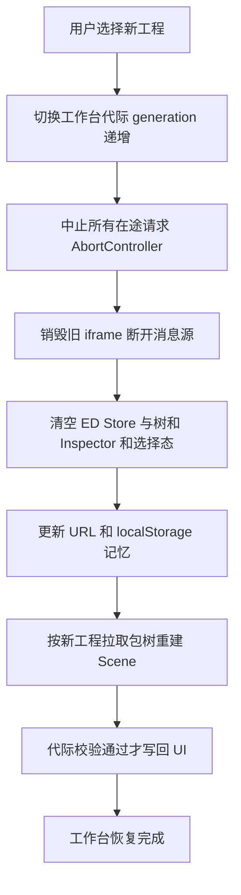
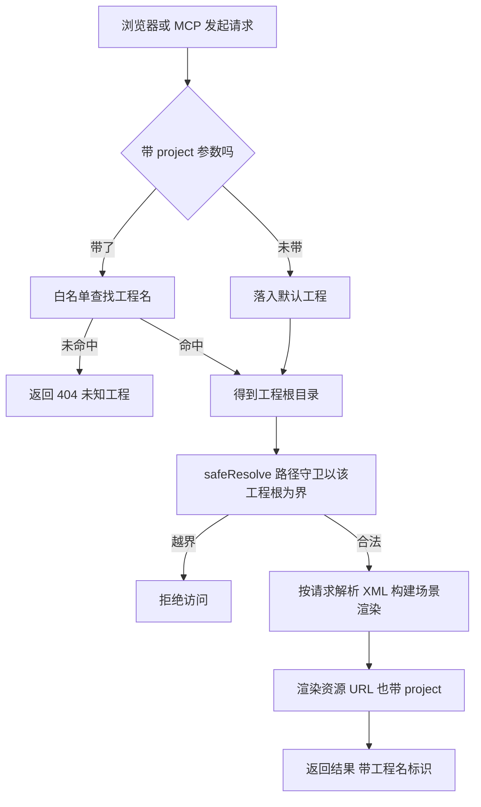

# FairyGUI 多工程切换设计方案（v2 修订版）

> 日期：2026-11-09
> 状态：P0-A（服务端）与 P0-B（前端工作台）已实施验收（2026-11-09，阶段 R，含浏览器实测：切换/URL 权威/双标签/资源链路）；P0-C（前端回归整理）/P1（MCP 多工程）待实施
> 背景：当前工作区已从 CC-Default（官方 Demo）手工替换为 fgui_game_42324（玄物麻将），替换动作是 mv 目录 + 重启进程。本方案分析"支持切换 FairyGUI 工程"的正确做法。
>
> **修订记录**：
> - v1（2026-11-09 初稿）：方案 A/B/C 对比，选方案 B，分两期。
> - **v2（2026-11-09 评审修订）**：外部技术评审提出 4 个 P0 问题与 1 个 MCP 架构建议，全部采纳合并：P0-1 渲染资源 URL 必须携带 project（现状核实属实，server.ts /view 的 toAssetUrl 无工程通道）；P0-2 工程上下文以 URL 为准、localStorage 只做记忆；P0-3 统一 API 入口覆盖全部模块含 POST 与 iframe postMessage 身份校验；P0-4 切换生命周期（AbortController 防过期请求覆盖）；MCP 改为每次调用独立解析 ProjectContext；测试计划扩充为 12 项；分期重排为 P0-A/B/C + P1。

## 1. 现状：root 是三处硬绑定 + 前端零工程概念

| 绑定点 | 位置 | 形态 |
|---|---|---|
| 服务启动 | src/server/main.ts | `process.env.FGUI_PROJECT_ROOT ?? "CC-Default"` 启动时定死，传 `createApp({rootDir})` |
| 服务路由 | src/server/server.ts | `createApp` 闭包持有 root/assetsRoot，全部路由共用；safeResolve(root, rel) 路径守卫以它为界 |
| **渲染资源 URL** | src/server/server.ts /view 路由 | `toAssetUrl` 生成 `/api/assets/<相对路径>`，**无任何工程通道**（P0-1 现状依据，已核实） |
| MCP | src/mcp/main.ts | `ctx = {rootDir: root}`，9 个工具全走 ctx.rootDir |
| 前端工作台 | src/editor/* | **无工程概念**。唯一工程信号是 `/api/project` 返回的 `root` 字段（顶栏 tb-project 显示用）；包树/画布/Inspector 全部只按"当前服务端唯一工程"假设工作 |

换工程现状 = `mv 目录 + 重启进程`（本次刚手工做过一遍）。能用，但：切换慢（重启）、不能对比着看两个工程、MCP 侧同样要改环境变量重启。

**有利事实（决定了切换可以做得很轻）**：

- 解析器（component-parser / package-parser）**零缓存**：无模块级 Map，getComponent 每次可 fresh；ui-asset-index 每请求重建（943ms 量级）。多工程按请求切换**没有缓存串扰问题**——这是本方案最大的可行性支点。
- 路径守卫 safeResolve(root, rel) 以参数形式收 root，只要每请求传入对应工程根，守卫语义自动生效。
- 组件寻址（`Basics/components/Button.xml` 相对路径）都是 assets 下相对路径，工程名作为新的最外层前缀叠加即可，不必改寻址语义。

## 2. 方案对比

### 方案 A：启动参数切换（重启级）

环境变量/CLI 参数选工程：`FGUI_PROJECT_ROOT=projects/xxx npm run serve`。

- 优点：零改动（现状规范化），把 projects/ 目录约定写进 README 即可。
- 缺点：切换 = 重启；浏览器多标签同时看两个工程做不到；工作台顶栏无切换入口，非开发人员不会用环境变量。
- 适用：只有开发者自己用、且极少切换。

### 方案 B：工程注册目录 + 请求级 project 参数（推荐）

`projects/` 目录下每个子目录是一个工程（含 assets/ 即算）；API 全部路由加可选 `?project=`；工作台顶栏加工程切换下拉。

- 优点：不重启切换；多标签可各看各的工程（project 是 URL 参数不是服务状态）；改动集中且小（见第 3 节）。
- 缺点：所有 API 调用点多一个参数要传（前端统一 API 入口一处解决）；MCP 工具签名要加可选参数；**资源 URL 链路必须同步携带 project（P0-1，v1 漏项）**。
- 适用：当前真实需求（官方 Demo 和麻将工程来回对比测试）。

### 方案 C：URL 前缀路由 /p/{project}/...

每工程一个路径前缀，REST 更纯粹。

- 优点：URL 即工程标识，缓存/分享友好。
- 缺点：所有路由表和前端 URL 拼接全改，`/view` iframe 与 postMessage 协议也要跟着动；收益与改动不成比例。
- 结论：不选。`?project=` 查询参数已满足需求（iframe src 带 query 天然支持）。评审同意见：保留方案 B，不改前缀路由。

**推荐：方案 B，按 P0-A / P0-B / P0-C / P1 四个小阶段实施**（第 7 节）。

## 3. 方案 B 设计（v2 修订）

### 3.1 工程注册与发现

```
projects/                     # 工程注册目录（约定：子目录含 assets 即一个工程）
  CC-Default/                 #   官方 Demo（现 CC-Default-orig 迁入）
  fgui_game_42324/            #   玄物麻将
  xxx/
```

- `listProjects(baseDir)`：枚举 projects/ 直接子目录，含 assets/ 的记为工程；目录名即工程名（kebab/字母数字，天然做白名单）。
- **向后兼容形态**：projects/ 不存在时回退现状——`FGUI_PROJECT_ROOT` 环境变量（或默认 CC-Default）作为唯一工程，`?project=` 参数被忽略或映射到该唯一工程。现有测试（fixtures 工作区就是单工程形态）零改动。
- 默认工程：projects/ 存在时取列表第一个（或配置 default）；`?project=` 缺省一律落到默认工程，保证旧链接/旧脚本不破。

### 3.2 服务端：root 从常量变工厂

```ts
// 现状（server.ts）
const root = path.resolve(opts.rootDir);          // createApp 闭包定死
// 方案 B
function projectRoot(name: string | null): string | null {
  // 白名单校验：name 必须命中 listProjects() 结果；null → 默认工程
  // 防路径注入：绝不拼接未校验的 name
}
// route() 内每请求：
const root = projectRoot(u.searchParams.get("project"));
if (!root) return json(res, 404, { error: "未知工程: xxx" });
const assetsRoot = path.join(root, "assets");
// 其余逻辑不变——safeResolve/buildScene/loadPackage 全部已按参数收 root
```

改动面：`route(req, res)` 的 root/assetsRoot 两个参数从闭包常量改为每请求解析；其余（safeResolve、findPackageDir、buildScene、渲染、diff、xml-write）**零改动**——它们本来就只依赖传入的 root。

新增一个路由：`GET /api/projects` → `[{name, packageCount}]`（顶栏切换器数据源）。

`/api/project` 响应增加 `project` 字段（当前工程名），前端顶栏显示改用它。

### 3.2.1 渲染资源 URL 必须携带 project（P0-1，v1 漏项已补）

`/view` 渲染 HTML 时的资源地址生成必须带上工程上下文，否则 iframe 虽然加载了正确工程的组件，但内部图片/字体/动画请求会落到默认工程的 assetsRoot——**组件结构正确、资源加载错误**，是最隐蔽的失败形态：

```ts
// 现状（server.ts /view）——资源 URL 无工程通道
toAssetUrl: (assetAbs) => `/api/assets/${path.relative(assetsRoot, assetAbs)...}`
// 修订——相对该工程 assetsRoot + 工程参数
toAssetUrl: (assetAbs) =>
  `/api/assets/${rel}?project=${encodeURIComponent(project)}`
```

覆盖范围（渲染器产出的**全部**资源 URL，逐项核对）：

| 资源 | 产出点 | 通道 |
|---|---|---|
| 图片（atlas 内/外） | 渲染器 toAssetUrl 回调 | `/api/assets/...?project=` |
| 字体（BMFont fnt + 贴图） | 渲染器 toAssetUrl 回调 | 同上 |
| jta 动画帧 | 渲染器（data URL 内联或 toAssetUrl） | 内联则天然隔离；走 URL 则同上 |
| `/api/assets` 静态路由 | server.ts | 按请求 project 解析 assetsRoot |

同时 `/api/assets` 路由本身的 assetsRoot 也按请求 project 解析（与 /view 同一次工厂调用，不重复实现）。

### 3.3 前端工作台：工程切换器与状态管理（P0-2/P0-3/P0-4 修订）

**工程上下文的唯一权威是 URL，localStorage 只负责记忆**（P0-2）：

```
http://localhost:7788/?project=CC-Default
http://localhost:7788/?project=fgui_game_42324
```

优先级（解析当前工程时）：

1. 当前页面 URL 的 `?project=`（标签页身份）
2. localStorage 记录的上次选择（记忆默认值）
3. 服务端默认工程（`/api/projects` 列表第一个）

localStorage 是多标签共享的——若以它为权威，标签 A 打开 Demo、标签 B 切到麻将后刷新 A，A 会变麻将，与"两标签互不干扰"冲突。**URL 是标签页的身份**，localStorage 只在"新开标签无 project 参数"时提供默认值。切换工程 = 更新 URL（history.replaceState 或跳转）+ 同步 localStorage + 重载工作台数据。

**统一 API 入口**（P0-3）：editor 五模块共 5 处直接 `fetch(`，先在 editor-page.ts 建统一入口，全部请求（含 POST）过这一处：

```js
function api(url, opts) {
  const u = new URL(url, location.origin);
  u.searchParams.set("project", currentProject);
  return fetch(u, opts);   // POST 的 project 在 query 上，无需改请求体
}
```

覆盖清单（逐模块核对，不做"简单字符串拼接"散落实现）：

| 模块 | 需要处理的请求 |
|---|---|
| project-tree | /api/project、/api/packages（包列表 + 组件列表） |
| scene-tree | /api/scene（Scene JSON） |
| canvas-host | /view iframe src、rel-bar 的 /api/ui-assets/usage、/api/component-graph |
| inspector | 其依赖的数据请求（如有） |
| editor-state | 切换工程时清理全部状态 |
| 渲染资源 | 图片/字体等 URL（服务端 toAssetUrl 已带，见 3.2.1） |

**iframe postMessage 工作区身份校验**（P0-3 延伸）：canvas-host 现有校验链 origin -> e.source -> documentId，需把 **project 一并纳入工作区身份**——切换工程后旧 iframe 的延迟消息（如 NODE_SELECTED）不得污染新工程的选择状态。documentId 每次加载新文档已生成新值，天然隔离大部分场景；但保险起见把 project 编入身份元组，校验不匹配直接丢弃。

**切换生命周期**（P0-4）：切换 = 有序销毁旧工程上下文，不是简单 reload 数据：



要点：**AbortController + 工作台 generation ID 双保险**——工程 A 的慢请求（包列表/场景 JSON）即使逃过 abort，回包时比对 generation 不匹配也丢弃，不会覆盖工程 B 的数据；旧 iframe 销毁后其 postMessage 源（e.source 比对）自动失效。

### 3.4 MCP：每次调用独立解析 ProjectContext（评审架构建议，替代 v1"ctx 改可变全局"）

不做"把 ctx.rootDir 改成可变全局"——并发调用会串工程。每次工具调用独立解析、独立传递：

```ts
interface ProjectContext {
  project: string;    // 工程名
  rootDir: string;    // 工程根
  assetsRoot: string; // assets 目录
}

function resolveProject(name?: string): ProjectContext {
  // 白名单解析；name 缺省 → 默认工程
}

function callTool(name: string, args: Record<string, unknown>) {
  const ctx = resolveProject(args.project as string | undefined);
  // ctx 作为参数传给具体工具，不落全局
}
```

- 新增工具 `list_projects`（枚举工程，无 project 参数）。
- 其余 9 个工具加可选 `project` 参数：**工具描述里写明默认值行为与组件路径基准**（"相对所选工程的 assets/"），让 Agent 明确知道操作的是哪个工程。
- 一个 Agent 可同时操作两个工程（不同调用带不同 project），并发无串扰。

### 3.5 安全与边界

- 工程名白名单 = projects/ 目录名枚举结果；请求带未知 project → 404（不猜、不回退静默）。
- safeResolve 每请求以对应工程根为界，跨工程路径访问在守卫层天然被拒。
- 路径注入：project 参数不参与任何路径拼接，只做 Map 查找（name -> root）。
- iframe postMessage 身份元组：origin -> e.source -> documentId + project（3.3）。

### 3.6 不做（明示边界）

- 跨工程场景 diff（a 在工程 1、b 在工程 2）：不做。同名组件跨工程对比语义弱，真需要时用导出 + 外部 diff 工具。
- 工程目录热监听（新增工程自动出现在下拉）：不做，刷新页面即重拉 /api/projects。
- 服务状态级"当前工程"（服务端记住切换）：不做。project 是请求参数不是服务状态——这保证了两个浏览器标签各看各的工程互不干扰。
- 跨工程组件复用/共享库语义：不做，超出本方案范围。

## 4. 请求流转（方案 B 生命周期）



要点：工程是请求的上下文不是服务状态——两个浏览器标签可各自带不同 project 参数互不干扰；同一 URL 刷新结果稳定；**资源 URL 与数据 URL 同链路携带工程上下文**（v2 新增节点）。

## 5. 类比理解

类比 IDE 的"打开文件夹"与"多根工作区"：

- 方案 A（环境变量）= VS Code `code <dir>`：一次打开一个，换 = 重开。
- 方案 B（projects/ + ?project=）= VS Code 多根工作区：一个窗口注册多个根，侧栏切换，各根独立索引。工程注册目录就是 `.code-workspace` 的文件版；`?project=` 参数就是每个编辑器标签各自记住自己属于哪个根。

关键差异：本方案 B 的"服务"始终是同一个进程（一个 VS Code 窗口），工程只是请求的上下文（标签的根属性），不是进程状态（不是重启窗口）。

**一级上下文原则**（评审提出，作为后续演进约束）：工程是一级上下文，组件、资源、场景、索引、编辑状态全部属于工程。未来即使加入缓存、搜索索引、AI 生成 UI、跨工程复用，一切状态挂工程之下，不会再出现工程上下文混乱。目标形态：FairyGUI UI 资产工作台（工程管理 / 资产索引 / 组件图谱 / Scene Tree / 可视化编辑 / XML 写回 / 每工程一个 UI Agent）。

## 6. 测试计划（v2 扩充：12 项）

双工程夹具工作区（projects/a + projects/b，各含一个包一个组件）+ 保留原单工程 fixtures 回归：

| 测试项 | 验收标准 |
|---|---|
| 单工程兼容 | 原有 fixtures 全部通过（projects/ 不存在形态） |
| 双工程注册 | /api/projects 正确识别 A、B |
| 工程切换 | 不重启服务，连续请求不同工程各自正确 |
| 未知工程 | 返回 404，不静默回退 |
| 路径越界 | 无法跨工程访问（safeResolve 按各工程根） |
| **资源隔离** | A、B 同名图片各归各工程（P0-1 核心） |
| **双标签页** | 两个标签（?project=a 与 ?project=b）分别保持自己的工程（P0-2 核心） |
| 刷新恢复 | URL 对应工程不变（URL 为权威） |
| **并发请求** | A、B 请求交错互不污染（P0-4 核心） |
| 旧请求覆盖 | 切换后旧请求（generation 不匹配）不覆盖新数据 |
| iframe 隔离 | 旧 iframe 消息不影响新工程选择状态 |
| MCP 隔离 | 同时调用不同工程的工具结果正确（ProjectContext 独立解析） |

其中资源隔离、双标签页、并发请求是最重要的三个回归项。服务端 10 项进 tests/server-check.ts（双工程夹具）；前端双标签页/旧请求覆盖项为手动验证项（进手动验证指南）。

## 7. 分期（v2 重排：四个可验收小阶段）

| 期 | 内容 | 触及文件 | 验收 |
|---|---|---|---|
| **P0-A 服务端多工程基础** | projects/ 注册目录 + listProjects + projectRoot 白名单工厂 + 全部 HTTP 路由支持 project（**含 /view toAssetUrl 与 /api/assets 的资源链路**）+ /api/projects + 单工程兼容模式 | server.ts（route 签名 + toAssetUrl + assets 路由）、main.ts、新 projects.ts | 服务端 10 项测试绿 + 原套件不退化 |
| **P0-B 前端多工程工作台** | 顶栏工程选择器 + URL/localStorage 状态管理（URL 为权威）+ 统一 api() 入口（含 POST）+ iframe src 与 postMessage 身份（含 project）+ 切换生命周期（AbortController + generation） | editor-page.ts、project-tree.ts、scene-tree.ts、canvas-host.ts、editor-state.ts | 手动验证：切换/双标签/刷新恢复 |
| **P0-C 多工程回归测试** | 双工程夹具 + 服务端 10 项断言 + 手动验证指南补多工程章节 | tests/、dev-docs/guides/ | 全部套件绿 + 手动项过 |
| **P1 MCP 多工程** | list_projects + 9 工具 project 参数 + 每调用独立 ProjectContext + MCP 隔离测试 | mcp/main.ts、mcp/tools.ts、tests/mcp-check.ts | MCP 隔离项绿 |

迁移动作（P0-A 前置，五分钟）：`CC-Default-orig -> projects/CC-Default`；`CC-Default（fgui_game_42324 内容）-> projects/fgui_game_42324`。纯目录移动，无代码。

## 8. 结论

选方案 B（v2 修订版）。核心依据三个：解析器零缓存（请求级切换无串扰）、safeResolve 已参数化（守卫零改动）、寻址是 assets 相对路径（工程名做前缀叠加不改语义）。改动集中在 root 的来源从"启动常量"变"请求工厂"，其余层全部不动。

v2 相对 v1 的关键补强：资源 URL 链路携带 project（P0-1，v1 完全漏掉的隐蔽错误形态）、URL 作为标签页工程身份（P0-2，修正 localStorage 为权威的多标签污染缺陷）、统一 API 入口与 iframe 身份校验（P0-3）、切换生命周期双保险（P0-4，AbortController + generation）、MCP ProjectContext 独立解析（防并发串工程）。评审结论：方向正确，补充约束后按 P0-A -> P0-B -> P0-C -> P1 顺序实施。

## 引用说明

- 现状绑定分析依据：src/server/main.ts（root 启动解析）、src/server/server.ts（createApp 闭包 + safeResolve(root, rel) 参数化守卫 + route 全路由 + /view toAssetUrl 资源 URL 无工程通道——P0-1 现状核实）、src/mcp/main.ts（ctx.rootDir）、src/editor/editor-page.ts（/api/project 的 root 字段为唯一工程信号）
- 零缓存结论依据：src/parser/component-parser.ts 与 src/parser/package-parser.ts（无模块级缓存结构）；src/scene/ui-asset-index.ts（索引每请求 fresh 构建）
- iframe postMessage 校验链现状：src/editor/canvas-host.ts 与 src/selection/component-selector.ts（origin -> e.source -> documentId）
- egret 姊妹项目同类机制参考：dev-docs/research/2026-11-05-egret项目对比与同步分析.md（工作台与 API 面对比）
- 相关经验：dev-docs/experience/2026-11-04-server旧进程旧代码不生效.md（长驻服务进程与数据目录生命周期注意点）
