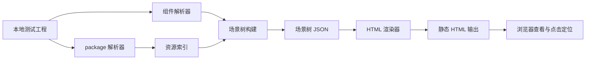

# fairygui-html-renderer POC 执行计划

- 日期：2026-10-28
- 状态：待执行
- 目标：验证「FairyGUI XML → HTML/CSS 静态渲染 + 组件定位」路线可行（目标 A），不做完整 Web 运行时（目标 B 不在本计划内）

## 一、背景与目标定位

用 AI 辅助开发 FairyGUI 界面时，痛点是「AI 搜到了组件，但网页画布无法可靠展示和定位」。本项目做一层轻量渲染能力：把本地 FairyGUI 工程（XML + 图片）渲染成 HTML，每个 DOM 节点保留原始 `id`/`name`/源文件路径，供组件搜索、高亮定位、后续 MCP 集成使用。

**目标 A（本计划）**：静态视觉正确 + 每个节点可追溯 + 点击选择定位。
**目标 B（不做）**：100% 还原交互、动画、时间轴——那是完整 Web Runtime，规模完全不同。

## 二、事实核实结论（2026-10-28 已本地验证）

### 2.1 参考仓库 thirdparties/OpenFairy-SDK-uGUI（submodule，commit 9ec9020）

| 方案声称 | 核实结果 |
|---|---|
| FairyXml.cs 定义 XML 模型 | 属实。含 `Package / Resource / Component / Controller / ControllerAction / Display / Relation / Gear / Extension / Transition / TransitionItem` |
| Migrate.cs 资源索引与依赖收集 | 属实（另有 Migrate.FilterPresentations / Localization / Names / Publication / TextShadows 分部类） |
| RelationAnchorBaker.cs / GroupLayoutBuilder.cs | 属实，位于 Assets/Plugins/OpenFairy/Editor/ |
| Basics 测试工程 | 属实，UIProject/assets/Basics/ 下 20 个 Demo XML + package.xml |
| 无 LICENSE 文件 | 属实（仓库全树无 LICENSE）。**结论：只参考设计思路与格式知识，禁止复制源码** |

### 2.2 关键发现：两种 XML 格式并存，必须以 CC-Default 格式为准

| 差异点 | CC-Default（原版 FairyGUI 编辑器格式） | submodule UIProject（OpenFairy fork 格式） |
|---|---|---|
| package.xml image 条目 | `<image id="dwwc2" name="5.png" path="/images/" scale="9grid" scale9grid="88,78,441,243" width="615" height="387"/>`，**带 width/height/scale9grid** | 仅 `id/name/path`，无尺寸与九宫格参数 |
| 组件 XML image 节点 | 仅 `src="资源id"`，**无 fileName，必须查 package.xml 索引** | 带 `fileName="images/pic.png"` 扩展可直接定位 |
| 组件扩展 | `extention="Button"` + `<Button/>` + controller + gearXxx | 结构较简单 |

结论：**renderer 以 CC-Default（原版）格式为第一优先级**；fork 格式兼容列为后续项。九宫格参数从 package.xml `scale9grid` 读取，映射 CSS `border-image-slice/width`；图片尺寸优先用 package.xml `width/height`，缺失时由 `` 自然尺寸兜底。

### 2.3 测试工程 CC-Default 概况

- 位置：`E:/DesignProjects/fairygui-html-renderer/CC-Default/`（FairyGUI-cocoscreator-demo 工程）
- 结构：`assets/` 下 17 个包（Bag、Basics、Chat、Cooldown、Guide、Joystick、ScrollPane、Transition、VirtualList 等），另有 `.objs/metas`（编辑器元数据）、`registry/`、`settings/`
- 覆盖度：Bag 包含真实嵌套组件（BagWin / BagGridSub / BagButton）、controller + gearColor、九宫格窗口图（615x387 scale9grid），比 Basics 示例更接近真实使用场景
- 已见未知类型：`<jta>`（非标准 FairyGUI 类型），POC 按未支持类型明确标注跳过，不悄悄渲染

## 三、整体架构



保留独立 Scene Tree（JSON 中间层），不直接 XML 转 HTML 字符串：后续 AI 搜索、语义定位直接查结构化节点，无需重新解析 XML 或遍历 DOM。

## 四、模块规划

```text
src/
  parser/
    package-parser.ts      解析 package.xml 建立 id 资源索引（含 scale9grid 尺寸）
    component-parser.ts    解析组件 XML 提取 displayList 坐标属性
  resolver/
    resource-resolver.ts   src id 查实际图片文件与尺寸，处理跨包 src pkg 引用
  scene/
    scene-builder.ts       递归展开子组件生成 Scene Tree（带源文件路径）
  renderer/
    html-renderer.ts       Scene Tree 输出 HTML DOM 与 CSS
  selection/
    component-selector.ts  点击节点返回 id name 源文件路径并高亮
demo/                      渲染产物输出目录（gitignore）
tests/                     验收脚本
```

## 五、分阶段执行计划

### P0：解析与最小渲染（图片 + 文本 + 坐标）

| 任务 | 内容 | 产出 |
|---|---|---|
| T0.1 | 工程探测：枚举 `CC-Default/assets/*/package.xml` | 工程清单 |
| T0.2 | package-parser：id→资源索引（name/path/width/height/scale9grid） | package-parser.ts |
| T0.3 | component-parser：displayList 中 image/text 两类节点解析 | component-parser.ts |
| T0.4 | html-renderer：absolute 定位输出静态 HTML | html-renderer.ts |
| T0.5 | 渲染验收：`assets/Bag/dot.xml`（最小）与 `assets/Basics/Demo_Image.xml` 同格式对照 | demo/ 下 HTML 文件 |

P0 验收：图片与文本按坐标正确显示、无资源丢失；未支持类型（如 jta）在输出 HTML 上标注跳过原因。

P0 技术选型：Node + TypeScript + fast-xml-parser（唯一新增依赖），tsx 直接运行脚本生成静态 HTML 文件，浏览器打开即可，无 dev server、无框架。

### P1：嵌套组件与视觉属性

| 任务 | 内容 |
|---|---|
| T1.1 | 子组件递归展开（component 节点 src 引用），保持显示顺序 |
| T1.2 | 九宫格 border-image 映射（scale9grid 参数换算） |
| T1.3 | 视觉属性：color、alpha、rotation、flip（hz/vt/both 用 scaleX/scaleY）、grayed（filter grayscale） |
| T1.4 | controller 默认状态：取 `selected` 页对应的 gear 值 |
| T1.5 | 验收：`assets/Bag/BagWin.xml`（窗口九宫格 + 嵌套 + 按钮）与 `assets/Basics/Demo_Image.xml`（flip/rotation/alpha/grayed） |

P1 验收：嵌套组件顺序正确；九宫格窗口拉伸不变形；flip 与 rotation 与编辑器视觉一致（允许明确记录的字体度量差异）。

### P2：选择定位与工程化

| 任务 | 内容 |
|---|---|
| T2.1 | 每个可见 DOM 节点挂 `data-fgui-id`、`data-fgui-name`、`data-fgui-src`（XML 相对路径） |
| T2.2 | component-selector：点击返回 id/name/层级路径/源文件；外发光高亮 |
| T2.3 | 未支持特性报告机制：HTML 顶部生成「未支持清单」（类型、数量、原因） |
| T2.4 | 验收：点击 BagWin 任意元素返回正确源文件与路径；报告清单准确 |

## 六、总体验收标准

- 图片和文本正确显示，无资源丢失
- 节点位置尺寸与设计一致（固定设计分辨率，字体差异允许且记录）
- 子组件正确展开，保持原始显示顺序
- 每个可见节点可追溯到原始 XML 文件与 id
- 复杂特性未支持时明确报告，不悄悄渲染错误
- 只读渲染：不写入不修改 CC-Default 原始工程

## 七、风险与边界

| 风险 | 处理 |
|---|---|
| submodule 无 LICENSE | 只参考格式知识与架构思路，禁止复制源码；必要时向仓库作者确认授权 |
| 字体度量差异 | FairyGUI 文本框尺寸是编辑器固定值，Web 字体宽度可能溢出；POC 用固定尺寸 + overflow hidden，记录差异 |
| `<jta>` 等未知扩展类型 | 未支持清单明确报告 |
| Transition / 剪裁滚动 / List 虚拟化 | 目标 B 范围，本计划不做，报告中列名 |
| CC-Default 含大量 PNG 与编辑器元数据 | 已加入 .gitignore 作为本地测试资产，不进版本库 |

## 八、引用说明

- OpenFairy-SDK-uGUI 仓库：https://github.com/OpenFairyGUI/OpenFairy-SDK-uGUI
- FairyXml.cs（XML 模型参考）：https://github.com/OpenFairyGUI/OpenFairy-SDK-uGUI/blob/main/Assets/Plugins/OpenFairy/Editor/FairyXml.cs
- RelationAnchorBaker.cs（关系布局参考）：https://github.com/OpenFairyGUI/OpenFairy-SDK-uGUI/blob/main/Assets/Plugins/OpenFairy/Editor/RelationAnchorBaker.cs
- FairyGUI 官方文档（XML 格式与组件体系）：https://www.fairygui.com/product
- CSS border-image（九宫格映射）：https://developer.mozilla.org/zh-CN/docs/Web/CSS/border-image
