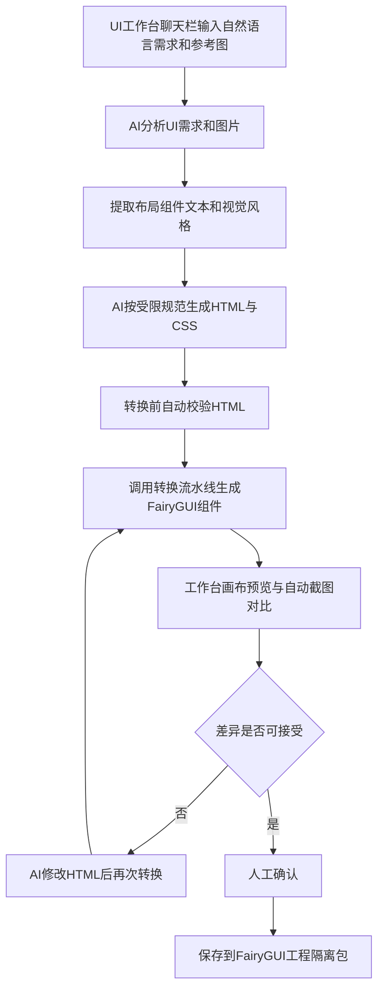

# UI 工作台接入需求文档（产品目标重定义与下一阶段计划）

- 日期：2026-10-29
- 性质：工作复盘中的产品目标与下一阶段计划记录（需求文档，非日报）
- 状态：规划已定稿，P0 待启动排期
- 关联文档：[未来需求计划-v3](./2026-10-29-未来需求计划-v3.md)（阶段 F/G 已验收完成，本文档是其阶段 H 的第一步落地拆解）

---

## 一、产品目标重定义

### 1.1 核心结论

开发 `fairygui-html-renderer` 的最终目的**不是实现一个功能完整的 FairyGUI 渲染器**，而是**尽快接入现有 UI 工作台**，实现「通过聊天输入 UI 需求和参考图，就能开始制作实际的 FairyGUI 界面」。

因此下一阶段**不再以 XML 支持率或渲染器功能数量为主要目标**，而是优先打通一条最小业务闭环。当前架构的主要风险已经不是「XML 能不能解析」，而是：

> AI 生成的 HTML，能否稳定转换为**可编辑、视觉接近参考图、又符合现有工程约束**的 FairyGUI 组件。

这个问题必须通过真实工作台任务验证，而不是继续增加渲染器特性。

### 1.2 真正需要的工作流程

这条链路是本产品真正追求的 MVP。只要跑通，UI 工作台就开始具备实际生产价值。

---

## 二、当前已有能力盘点（2026-10-29 全部验收通过）

今日提交后，以下能力已足以开始工作台接入实验，**不需要等 Renderer 支持 FairyGUI 所有复杂特性**：

| 当前已有能力 | 来源里程碑 | 工作台可以怎样使用 |
|---|---|---|
| XML → HTML 渲染 | P0 / P1 / P2 + 阶段 A / E | 预览已有 FairyGUI UI |
| Scene Tree JSON | 阶段 A / B | 获取组件结构化数据 |
| 只读工作区服务（HTTP 五路由） | 阶段 B | 工作台画布数据源 |
| 全工程搜索 + 画布深度定位 | 阶段 C | 查找现有组件 |
| MCP 四工具（list / locate / render / screenshot） | 阶段 D | Agent 查看与定位能力，实机闭环已验证 |
| 视觉还原（gearColor / 描边 / 标题注入 / list / loader） | 阶段 E | 提升预览可信度 |
| HTML → XML 转换 POC | 阶段 F | 将 AI 生成的 HTML 输出为 FairyGUI 组件（像素级一致 + 编辑器实测修改保存通过） |
| 可重复转换流水线（extractor / style-mapper / fairy-writer / validator + 转换报告） | 阶段 G | 稳定批量转换，三样本验收 |
| browser-selftest Skill | 2026-10-29 | 自动打开、截图并验证 UI |

### 2.1 阶段命名约定（避免混淆）

本项目历史里程碑已有两套编号，本文档新增第三套，含义互不重叠：

| 编号体系 | 含义 | 状态 |
|---|---|---|
| P0 / P1 / P2 | 2026-10-28 渲染 POC（解析 / 嵌套 / 选择定位） | 已完成 |
| 阶段 A ~ H | v3 双向转换路线图 | A-G 已完成，H 为长期目标 |
| **工作台 P0 / P1 / P2** | **本文档定义的工作台接入阶段** | **规划中** |

---

## 三、下一阶段计划：工作台接入三阶段

优先级顺序：**工作台 P0 > P1 > P2**。渲染器特性扩展（原阶段 E 思路）降级为按需穿插。

### 工作台 P0：接入工作台

| 项 | 内容 |
|---|---|
| 目标 | 聊天栏可以调用 Renderer、预览器、转换器 |
| 验收标准 | 通过聊天完成一次 HTML → FairyGUI 组件创建 |
| 范围约束 | **暂不实现**自动选择现有组件和复杂语义搜索。先让 Agent 创建**新组件**，绕开此前的组件定位难题；新建组件稳定后再做已有组件修改（P2） |

### 工作台 P1：参考图生成

| 项 | 内容 |
|---|---|
| 目标 | 上传 UI 截图 + 输入需求 |
| 验收标准 | AI 生成近似界面并转换成 FairyGUI |

### 工作台 P2：迭代修改

| 项 | 内容 |
|---|---|
| 目标 | 聊天修改已经生成的 UI |
| 验收标准 | 修改后正确更新组件，**不产生重复资源** |

---

## 四、第一个真实验收用例

### 4.1 用例描述

参考图：Open World Mobile RPG Game UI UX（Behance 参考截图，见引用说明）。

在 UI 工作台输入：

> 参考这张图，生成一个游戏道具详情弹窗。包含道具图标、名称、品质、描述、数量和确认按钮。生成后保存为 FairyGUI 可编辑组件。

预期链路：AI 根据图片和要求生成 HTML → 转换成 XML → 在画布中展示。

### 4.2 第一版验收重点（只看以下五条）

1. 组件能够成功写入测试 FairyGUI 工程（CC-Default 隔离新包，沿用阶段 F/G 约定）。
2. FairyGUI 编辑器可以正常打开。
3. 主要布局、图片、文本正确。
4. 元素在 FairyGUI 中仍然可以独立编辑。
5. 生成失败时不破坏原工程。

---

## 五、技术边界

### 5.1 分层定位

- **HTML 是 AI 的设计与生成中间层**（AI 最熟悉 Web 技术，生成效率最高）。
- **FairyGUI XML 是最终交付格式**。
- 但**并不是任意 HTML 都能转换成 FairyGUI**——这是本产品的核心技术边界。

### 5.2 受约束的 HTML 生成规范（P0 必须先行）

提供一套受限生成规范并在转换前自动校验，而不是让 AI 自由生成复杂 HTML 后再修复各种无法转换的 CSS：

1. **限制布局类型**：如仅允许 absolute 定位与受限的 flex，Flex/Grid 只取浏览器计算后的最终位置（沿用阶段 G 规则）。
2. **限制支持的 CSS 属性**：以阶段 G style-mapper 已验证的映射规则为白名单基线，逐步扩充。
3. **限制图片资源格式**：明确 PNG 及引用方式约束。
4. **转换前自动校验**：在现有 validator（±1px 回读对照）之前增加规范静态校验，不合规直接给出可修改的诊断信息，而非静默降级。

理由：受约束生成 + 前置校验，比自由生成后修复要稳定得多。

### 5.3 写入安全边界（沿用并强化既有约定）

1. **第一阶段通过临时目录生成和验证组件**，人工确认后才写入真实 FairyGUI 工程。
2. **禁止 Agent 直接修改原始工程**；写入目标仅限测试工程内新建的隔离包（拒绝覆盖既有包，沿用 fairy-writer 现有保护）。
3. 生成失败时原工程必须不受影响。

### 5.4 本阶段明确不做

- 现有组件自动选择与语义搜索复用（P0 明确排除）。
- 修改既有 FairyGUI 组件（推迟到工作台 P2）。
- 渲染器 XML 支持率扩张（降级为按需穿插）。
- 完整动画 / 交互运行时还原。

---

## 六、下一步行动

1. 将本文档作为项目最高优先级输入：**UI 工作台聊天输入 → AI 生成 HTML → FairyGUI XML → 画布预览 → 人工确认落盘**。
2. 启动工作台 P0 前按项目规范拆解独立执行计划（含受约束 HTML 规范初版清单、聊天栏调用转换流水线的接口形式）。
3. 验收用例按第四节执行，验收结果记入 `dev-docs/progress-result/`。

---

## 引用说明

- 本文档来源：2026-10-29 工作复盘讨论（产品目标重定义与下一阶段计划）
- 阶段能力依据：`dev-docs/progress/执行进度.md` 及 `dev-docs/progress-result/` 各阶段执行报告（阶段 F / G 为转换链路直接基础）
- 路线图衔接：[2026-10-29-未来需求计划-v3.md](./2026-10-29-未来需求计划-v3.md)（本工作台三阶段是其中阶段 H 的第一步落地拆解）
- 参考图：Behance「Open World Mobile RPG Game UI UX」（用户提供的参考截图链接，原始 Behance 项目页待补充归档）
- FairyGUI 官方文档：https://www.fairygui.com/product
