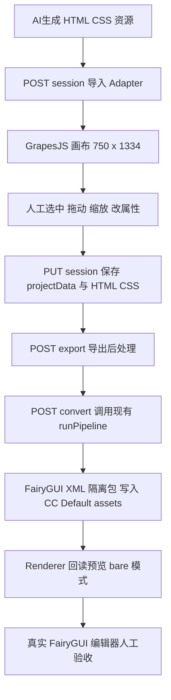
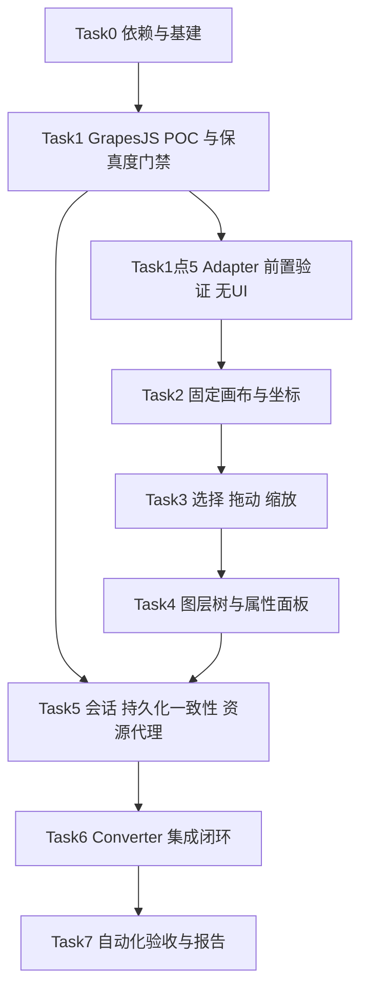
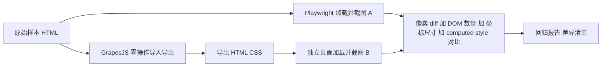

# UI Editor P0 执行计划

- 项目：fairygui-html-renderer
- 上游规划：[UI Editor P0：基于 GrapesJS 的游戏 UI 可视化编辑器技术验证与实施方案.md](UI%20Editor%20P0：基于%20GrapesJS%20的游戏%20UI%20可视化编辑器技术验证与实施方案.md)
- 阶段：UI 编辑器 P0（区别于渲染器流水线早期已完成的 P0/P1/P2/阶段A-G，本阶段报告文件命名为 `UI编辑器P0-执行报告.md`）
- 日期：2026-11-04
- 状态：执行基线（含两轮同日评审修订：一轮为拖动按需提升/保存一致性/资源路径约定/CSS 差异报告/Adapter 前置验证；二轮为差异分级门禁/嵌套坐标语义/转换输入路径核实），Task 0 部分完成（submodule 已就位），待执行
- 前置条件：XML→HTML、HTML→FairyGUI XML 双向链路已可用（阶段 A-G 验收通过）

---

# 一、类比理解

把整个编辑器想象成一个「带图纸台的绘图工作桌」：

- **GrapesJS 画布** = 桌面中央那张描图纸：你只能用手（鼠标拖动、控制点缩放）在纸上改图，纸上的内容归 GrapesJS 管。
- **React 外壳** = 桌子四周的工具架（图层目录、标尺面板、属性抽屉）：工具架读取纸上的状态展示给你，但工具架本身不直接碰纸。
- **Import/Export Adapter** = 图纸的进出口翻译官：AI 生成的 HTML 从门口进来时盖编号章（data-fgui-node-id），出门时检查编号完整、资源齐全。
- **现有 Converter** = 桌子另一头的印刷机：翻译官交出的图纸送进印刷机印出 FairyGUI XML，印刷机已有、本阶段绝不重造。
- **editor-workspaces 会话目录** = 每张图纸一个档案袋：AI 原稿（source）封存不动，编辑稿（editor）和印刷结果（output）放同一档案袋的不同隔层。

一句话边界：**React 永远不碰画布里的 DOM，GrapesJS 永远不碰画布外的 UI，Converter 永远不被编辑器重写。**

---

# 二、目标与范围回顾

## 2.1 本阶段交付目标

AI 生成 HTML → 导入编辑器 → 固定 750×1334 画布人工调整（选中/拖动/缩放/属性）→ 保存恢复 → 导出 HTML/CSS → 现有 Converter 生成 FairyGUI XML → Renderer 回读 → 真实 FairyGUI 编辑器打开验收。

## 2.2 明确不做（照抄上游规划，执行中不得偷偷扩大）

从零拖拽创建 UI、素材库、协作、云项目、AI 改节点、AI 视觉标注、动画编辑、响应式布局、FairyGUI XML 直接编辑、修改原始 FairyGUI 工程、完整资源管理、图层拖拽排序/隐藏/锁定。

---

# 三、已完成准备（2026-11-04）

第三方库源码已按用户决策全部以 git submodule 形式加入 `thirdparties/`（浅克隆 + 锁定 release tag，仅作源码参考；运行时依赖一律走 npm 安装，版本对应关系如下）：

| 库 | submodule 路径 | 锁定版本 | npm 安装版本 | 源码参考价值 |
|---|---|---|---|---|
| GrapesJS | thirdparties/grapesjs | v0.23.9 | ^0.23.9 | 导入导出保真度排查、dragmode/resizer 行为确认（最高） |
| React | thirdparties/react | v19.3.1 | ^19.3.1 | 事件与 ref 边界问题排查 |
| Vite | thirdparties/vite | v8.3.5 | ^8.3.5 | dev server 代理、构建问题排查 |
| shadcn/ui | thirdparties/shadcn-ui | shadcn@4.9.0 | CLI 最新 + 按需 add 组件 | 组件源码直接复制进工程（shadcn 模式即复制） |
| Lucide | thirdparties/lucide | 0.265.0 | lucide-react 最新稳定 | 图标源查阅 |
| Playwright | thirdparties/playwright | v1.64.1 | @playwright/test ^1.64.1 | 截图/对比 API 行为排查 |

已踩坑并沉淀：Windows 长路径导致 react 浅克隆检出残缺、absorbgitdirs 跨盘符硬链接失败，见 [windows-git-clone-longpaths-and-cross-drive-submodule.md](../experience/windows-git-clone-longpaths-and-cross-drive-submodule.md)。**后续克隆大型仓库一律加 `-c core.longpaths=true`。**

---

# 四、Task 0：依赖安装与工程基建

## 4.1 工程位置决策

editor 前端并入现有工程：`src/editor/`（用户已确认）。共用根 `package.json` 与根 `tsconfig.json`，现有 `src/`（Node 转换器/服务器）代码不动。

## 4.2 依赖安装

根 `package.json` 新增：

```jsonc
// dependencies
"react": "^19.3.1",
"react-dom": "^19.3.1",
"grapesjs": "^0.23.9",
"lucide-react": "最新稳定版",
// devDependencies
"@types/react": "^19",
"@types/react-dom": "^19",
"@vitejs/plugin-react": "^5",
"vite": "^8.3.5",
"tailwindcss": "^4",
"@tailwindcss/vite": "^4",
"@playwright/test": "^1.64.1"
```

根 `tsconfig.json` 调整（最小改动）：

```jsonc
"jsx": "react-jsx",
"lib": ["ES2022", "DOM", "DOM.Iterable"]
```

新增 scripts：

```jsonc
"editor": "vite src/editor",          // root=src/editor，自动读取其中的 vite.config.ts
"editor:build": "vite build src/editor",
"editor:e2e": "playwright test",
"check:grapes": "tsx tests/grapes-fidelity.ts",     // GrapesJS 导入导出保真度回归（结构化差异报告）
"check:editor": "tsx tests/editor-session-check.ts"   // 服务端 session 接口断言，沿用现有 check 风格
```

shadcn/ui：`npx shadcn@latest init`（tailwind v4 模式）后按需 `add button input label select slider scroll-area`，不引入更多组件。P0 面板控件少于 10 个，组件按 shadcn 模式复制进 `src/editor/components/ui/`。

`.gitignore` 追加：`src/editor/dist/`、`editor-workspaces/`、`playwright-report/`、`test-results/`。

## 4.3 目录结构

```
src/editor/
  index.html
  vite.config.ts          // root 固定、server.proxy: /api -> http://localhost:7788（资源走服务端 asset 路由，不走 Vite 代理）
  main.tsx
  App.tsx                 // 五区布局：顶栏 / 图层 / 画布 / 属性 / 状态栏
  styles/global.css       // tailwind 入口
  grapes/
    editor-instance.ts    // grapesjs.init 封装（单例，storageManager 关闭）
    canvas-config.ts      // GameCanvasConfig 默认值 750x1334 #808080 + zoom API 封装
    use-editor.ts         // React hooks：useSelectedComponent / useLayers / useProjectState
    node-name.ts          // 图层显示名：data-fgui-node-name > id > class > tag+序号
  adapter/
    types.ts              // GameCanvasConfig / EditorInput / EditorOutput / ImportDiagnostics
    node-id.ts            // data-fgui-node-id 保留与分配
    import.ts             // 导入校验 + 诊断 + 加载进 GrapesJS
    export.ts             // 导出后处理（剥离 gjs 辅助属性、重复 id 校验、资源校验）
  components/
    TopToolbar.tsx        // 返回/Undo/Redo/Zoom/Preview/Save/Export
    LayerTree.tsx
    PropertyPanel.tsx     // Transform / Appearance / Typography / Image 分节
    StatusBar.tsx
    ui/                   // shadcn 复制产物
server 端新增：
src/server/editor-session.ts   // 6 个 /api/editor/* 路由实现
src/server/ 目录挂载点          // server.ts 的 route() 内按前缀分发
测试：
tests/grapes-fidelity.ts       // 保真度差异报告（npm run check:grapes）
tests/editor-session-check.ts  // session 接口断言（check 风格）
tests/e2e/                     // Playwright 用例
tests/fixtures/editor/sample-{a,b,c,d,e,f}/
src/editor/dev/                // adapter-selftest 无 UI 测试入口（Task 1.5）
运行期数据（gitignore）：
editor-workspaces/<sessionId>/{source/,editor/,output/}
```

## 4.4 运行架构与数据流



现有两个进程并存：`npm run serve`（Node server，端口 7788，含新增 /api/editor/* 与 asset 路由）与 `npm run editor`（Vite dev，默认 5173，仅 /api 代理到 7788）。画布内资源解析靠 iframe base href 指向 asset 路由（见第六节资源解析与资源路径约定），不经 Vite。

## 4.5 验收

- `npm run editor` 启动空白五区布局页面；
- `npx tsc --noEmit` 全工程通过（含 src/editor/*.tsx）；
- `npm run serve` 不回归（`npm run check:server`、`npm run check:convert` 全绿）。

---

# 五、核心数据结构（src/editor/adapter/types.ts）

```ts
export interface GameCanvasConfig {
  width: number;               // 默认 750
  height: number;              // 默认 1334
  backgroundColor?: string;    // 默认 #808080
  zoom?: number;               // 显示缩放，不影响导出坐标
}

export interface EditorInput {
  html: string;                // AI 生成 HTML（不含 <!DOCTYPE 等文档壳也可，Adapter 容错）
  css: string;
  assets: string[];            // 相对会话目录路径，如 "assets/icon.png"
  canvas: GameCanvasConfig;
  sourceRevision: string;      // 服务端会话版本号，形如 "r1"
}

export interface ImportDiagnostic {
  level: "error" | "warning" | "info";
  code: string;                // 如 UNSUPPORTED_CSS、MISSING_ASSET、DUPLICATE_NODE_ID
  target?: string;             // 节点 id / 选择器
  message: string;
}

export interface EditorOutput {
  html: string;
  css: string;
  projectData: object;         // editor.getProject() 原样
  assets: string[];
  sourceRevision: string;
  nodeIdentityVersion: number; // P0 固定 1
  diagnostics: ImportDiagnostic[];
}
```

节点 ID 规则（node-id.ts）：属性名 `data-fgui-node-id`；导入时已有则保留、无则按文档顺序生成 `node_001` 递增；编辑过程中不重排、不回收；导出前校验唯一性，重复即报 error 级诊断且拒绝保存导出。

---

# 六、HTTP 接口设计（新增 src/server/editor-session.ts）

沿用现有 Node 原生 http + route() 分发风格。会话根目录：仓库根 `editor-workspaces/`（环境变量 `FGUI_EDITOR_WORKSPACE` 可覆盖）；转换输出根：现有工程 `assets/`（即 FGUI_PROJECT_ROOT 下，默认 CC-Default）。

统一错误结构：`{ "error": { "code": "...", "message": "...", "detail": {...} } }`。

| 方法 | 路由 | 请求体 | 成功响应 | 失败 |
|---|---|---|---|---|
| POST | /api/editor/session | `{name, html, css, assets, canvas}` | 200 `{id, dir, sourceRevision:"r1", diagnostics}` | 409 SESSION_EXISTS |
| GET | /api/editor/session/:id | - | 200 `{id, sourceRevision, html, css, assets, canvas, projectData, updatedAt}` | 404 SESSION_NOT_FOUND |
| PUT | /api/editor/session/:id | `{html, css, projectData, assets, sourceRevision}` | 200 `{sourceRevision:"rN+1", updatedAt}` | 409 REVISION_CONFLICT；404；400 |
| GET | /api/editor/session/:id/project | - | 200 project.json 原文（application/json） | 404 PROJECT_NOT_FOUND |
| POST | /api/editor/session/:id/export | `{projectData}` | 200 `{html, css, assets, diagnostics}` | 404；400 DUPLICATE_NODE_ID |
| POST | /api/editor/session/:id/convert | `{outPkgName?, width?, height?}` | 200 `{pkgId, files, report, validation, outDir}` | 400 PKG_EXISTS（不传 force 拒绝覆盖） |
| GET | /api/editor/session/:id/asset/* | - | 200 资源文件流 | 404 ASSET_NOT_FOUND；400 路径越界 |

说明：

1. POST session 服务端落盘 `source/index.html + styles.css`（AI 原稿，此后服务端与编辑器都不再写 source）与 `editor/project.json` 初始态；转换通过直接 import 现有 `runPipeline`（src/convert/transform.ts），以会话 `editor/index.html` 为流水线输入（资源相对解析基于该目录，Converter 零改动），完成后产物写 `output/validation-report.json`。
2. 保存采用「写 `.tmp` 临时文件 + rename 原子替换」（现有阶段 B 已有同款做法则直接复用）。
3. sourceRevision 乐观锁：PUT 时请求体 revision 与磁盘 revision 不一致返回 409，detail 带 expected/actual。
4. 画布内资源解析：编辑器为画布 iframe 注入 `<base href="/api/editor/session/:id/">`，HTML 中的相对路径（`assets/x.png`、CSS `url()`）自动命中 asset 路由；导出 HTML 原样保留相对路径，不做改写。
5. 安全校验（全部强制）：
   - `id`、`outPkgName` 必须匹配 `^[A-Za-z0-9_-]{1,64}$`（拒绝目录穿越第一步）；
   - 所有文件读写经现有 safeResolve 限定在会话目录内；
   - 请求体大小上限 10MB（413 PAYLOAD_TOO_LARGE）；
   - assets 路径必须为会话目录相对路径，拒绝 `..`、绝对路径、协议前缀；
   - convert 输出仅允许 `<FGUI_PROJECT_ROOT>/assets/<outPkgName>` 且该目录已存在时直接 400（复用 runPipeline 既有保护）；
   - 不提供任何修改 FairyGUI 原始包的接口。

## 资源路径约定（2026-11-04 评审新增，P0）

1. 会话内资源统一为会话相对路径（`assets/...`）；导出 HTML/CSS 原样保留路径，不做绝对路径改写 —— 保证导出目录结构（editor/index.html + editor/assets/）与现有 Converter `extractFromHtml` 的相对解析规则一致，Converter 侧零改动。
2. 导入时检查三类引用：HTML 的 src/href、CSS 的 url()、图片替换后的 src。`./assets/x.png` 与 `assets/x.png` 规整化等价；`../` 跨出会话目录、`/` 绝对路径、`http(s)://` 外链一律记入诊断（error 级阻断保存导出，warning 级提示建议复制进会话 assets）。已知边界（2026-11-04 核实）：CSS background-image url() 的图片在现有 Converter 不产出资源（extractor 仅提取 backgroundColor），一律记 warning，P0 样本图片一律用 ``。
3. 属性面板替换图片只允许填会话相对路径，先经存在性检查（asset 路由）再写入 src。
4. 验收测试五项（纳入 Task 5 与 e2e）：HTML 相对路径 src 显示、CSS url() 显示、替换图片后显示、导出 HTML 路径与导入一致、Converter 转换后资源清单与 assets 目录核对一致。

验收：`npm run check:editor` 断言以上行为（创建/读取/保存/冲突 409/导出/convert 拒绝覆盖/穿越路径 4xx/恢复不一致提示），风格对齐 tests/server-check.ts。

---

# 七、任务拆分（Task 1-7）

总顺序与依赖：



## Task 1：GrapesJS POC + 保真度门禁（约 1.5 天，关键门禁）

步骤：

1. `src/editor/index.html + main.tsx + App.tsx`：五区静态布局（空面板占位），GrapesJS 容器挂中栏；
2. `grapes/editor-instance.ts`：init（plugins 关闭默认预设、storageManager off、canvas styles 配置留 Task 2 填充）；
3. `grapes/load-html.ts`：载入 HTML/CSS；
4. 保真度实验样本（评审要求，不只手工样本）：Sample A、sample-final-item（模拟 AI 产物的道具详情弹窗，即最终验收场景底稿）、现有 convert fixtures（tests/fixtures/convert/ 的 hello/nested/flex-grid）交叉验证；拿到真实 AI 产物后立即补入实验；
5. 结构化差异报告脚本 `tests/grapes-fidelity.ts`（`npm run check:grapes`，Playwright chromium API 驱动 dev server 页面，页面内完成 导入 → 零操作 → 导出 → 回读对比），每样本输出 JSON 报告：

```json
{
  "sample": "sample-a-popup",
  "summary": { "totalNodes": 20, "semanticDiffs": 0, "geometryDiffs": 0, "assetDiffs": 0, "cssFormatDiffs": 3 },
  "differences": [
    { "kind": "css-format", "severity": "info", "selector": ".close-btn", "property": "color", "before": "#fff", "after": "rgb(255, 255, 255)" },
    { "kind": "semantic", "severity": "blocker", "selector": ".title", "property": "id", "before": "title", "after": "" }
  ]
}
```

   差异分级（二轮评审修订）：

   | 级别 | 范围 | 门禁 |
   |---|---|---|
   | semantic（blocker） | 节点缺失/多出、层级变化、id/class/data-fgui-node-id 丢失、文本内容变化 | 必须为零 |
   | geometry | 坐标/尺寸 | 测量误差 ≤1px 视为零（浮点取整容差） |
   | asset | 资源引用丢失/路径变化 | 必须为零 |
   | css-format（info） | CSS 文本格式化、规则重组、等价表达（颜色写法、简写展开、属性顺序） | 记录不作为失败依据；computed style 比对先做视觉等价归一化（颜色/简写归一后再比） |

   对比维度：节点数量与层级、节点 id/class、资源引用、关键 CSS（规划 6.4 清单）、画布内 getBoundingClientRect 几何、computed style 抽样。**机器判定门禁：semanticDiffs/geometryDiffs/assetDiffs 全零才放行，cssFormatDiffs 仅记录**；像素 diff（第九节）仅作辅助信号。报告落盘 `editor-workspaces/fidelity/<sample>-noop-report.json`（gitignore）。

门禁（上游规划第十五节第 2、10 条）：报告非零时，**先在 `thirdparties/grapesjs` 源码中定位解析/序列化原因并评估修复成本（配置项优先，如 skipParse/保留未知属性），再向用户报告决策：修复后继续 or 调整方案**。不允许带病进入后续任务。

产出：

- `npm run check:grapes` 可重复回归（升级 GrapesJS 版本后重跑，评审要求）；
- 兼容性报告初版 `dev-docs/progress-result/UI编辑器P0-GrapesJS兼容性报告.md`，回答四问（能否无损导入现有 AI HTML / 能否保留原始 CSS 与 DOM 结构 / 拖动缩放能否只改目标节点 / 导出能否被现有 Converter 正确处理），随 Task 3 与 Task 6 完善后于 Task 7 定稿。

## Task 1.5：Adapter 基础能力前置验证（约 0.5 天，无 UI，2026-11-04 评审新增）

评审结论：Adapter 与节点 ID 是编辑器成立的基础，不完全依赖图层和属性面板，不等 Task 4/Task 5。

1. `src/editor/dev/adapter-selftest.html + main.ts`：Vite 多页面测试入口（加载 adapter 模块，暴露 window 调用接口）；
2. Playwright 打开该页，逐样本驱动验证四件事：HTML 导入与诊断对象生成、data-fgui-node-id 分配/保留/唯一性、HTML/CSS 导出后处理（剥离 gjs 辅助属性）、资源路径规整（第六节资源路径约定）；
3. 断言并入 `npm run check:grapes` 同脚本或独立 `tests/adapter-check.ts`。

验收：五样本 + sample-final-item 全部通过；结构性缺陷（如 grapesjs 导入丢失未知属性导致 ID 无法挂载）在本步暴露，不计入 UI 任务。

## Task 2：固定画布与坐标系统（约 0.5 天）

1. `canvas-config.ts`：默认 `{width:750, height:1334, backgroundColor:"#808080"}`；
2. 画布固定尺寸 + 居中（外层 CSS 弹性布局），窗口变化只改显示缩放；
3. 顶栏 Zoom In/Out/Fit（editor.Canvas zoom API），zoom 仅显示层；
4. 验证：拖动一元素后其 style left/top 与画布设计坐标 1:1（iframe 内坐标即设计坐标），浏览器窗口缩放/画布 zoom 不影响该值。

验收 = 750×1334 画布正确显示 + 坐标不随窗口变化。

## Task 3：元素选择、拖动、缩放（约 1 天）

1. 选择：GrapesJS 内建 selector（点击/边框/控制点/名称徽标），点击空白取消选中；
2. 拖动「按需提升」策略（2026-11-04 评审修订）：
   - 仅当用户主动拖动/缩放某节点时，才允许改变该节点的定位属性；禁止任何「导入即全量转 absolute」「拖 A 动 B」的隐式改写；
   - 拖动开始前快照目标节点原始布局属性（position/display 及 flex 相关），存入组件自定义属性（如 `fgui-origin-layout`）；拖动只修改目标节点，不触碰父容器；
   - 拖动结束将布局模式变化写入变更记录（诊断日志），Undo 必须能完整还原到原始布局属性；
   - GrapesJS drag mode 对 static 元素的默认行为已在 Task 1 冒烟确认；若默认行为与本策略冲突，在 editor-instance 层覆写（自定义 DragMode/事件拦截），不修改 thirdparties 源码；
3. 缩放：Resizer 四角控制点，step=1，保持宽高比逻辑默认（图片不强制锁比，除非 shift）；
4. 数值显示：拖动过程实时显示 X/Y/W/H 徽标；
5. 坐标语义（二轮评审修订）：属性面板与拖动写入的都是相对父容器（offsetParent）的 left/top，不是画布绝对坐标；禁止用 getBoundingClientRect 绝对值直接回写。验证三点（纳入 e2e）：
   - 嵌套坐标：父 x=100/y=100 内子 x=30/y=30，拖动子节点后仅改子的相对 left/top，父与兄弟坐标不变；
   - 滚动容器：父 overflow:auto 滚动后拖动，坐标换算仍正确；
   - transform 缩放：画布 zoom 与节点 transform: scale 下拖动终点换算正确。

验收 = T02/T04/T05 手工通过（选中 100% 正确、拖动缩放误差 ≤1px）；补充断言：拖动后父容器 position/display 及全部兄弟节点坐标 diff 为零、嵌套/滚动/缩放三场景坐标换算正确（均纳入 e2e），结论写入兼容性报告问题 3。

## Task 4：图层树与属性面板（约 2 天）

1. `use-editor.ts`：单例 editor + 事件订阅（component:selected / update / undo redo 计数）转 React state；
2. `LayerTree.tsx`：递归渲染真实 DOM 树（getWrapper 起始，不做任何 DOM 结构美化改写），节点名走 `node-name.ts` 四级优先级；点击双向同步选中；展开/收起；
3. `PropertyPanel.tsx` 四分节，全部 React 受控控件直连 component API（不用 GrapesJS StyleManager DOM，避免两套 UI 混合）：
   - Transform：X/Y（style left/top）/W/H/Rotation（transform rotate），输入与画布双向实时；
   - Appearance：Opacity(0~1)/背景色/边框色/边框宽/圆角；
   - Typography：仅文本节点显示，内容/字号/颜色/字重/对齐/行高；只改 style 与 text 内容，不动层级；
   - Image：仅 img 显示，src 路径展示 + 预览（iframe base href 命中服务端 asset 路由）+ 修改路径 + 存在性检查（asset 路由或导入诊断复用）；
4. 快捷键：Ctrl+Z / Ctrl+Shift+Z / Ctrl+S（保存调 PUT session），走 GrapesJS Keymaps 或全局监听，二者取实现更简者。

验收 = T06/T07/T08/T09/T10/T11 手工通过；不依赖代码即可完成「移动图片、改标题颜色、拉宽按钮」三件事。

## Task 5：服务端会话 + 持久化一致性 + 资源代理（约 2 天）

Adapter 基础能力已在 Task 1.5 验证，本任务聚焦持久化与接口完善：

1. `adapter/import.ts` 补全：DOMParser 校验 HTML/CSS → 资源存在性检查 → 画布尺寸检查 → 逐节点补 data-fgui-node-id → 生成 ImportDiagnostics（含规划 6.4 CSS 兼容清单；flex/grid 存在仅记 warning，不转换布局）→ 加载进 GrapesJS；失败必须报错，不允许「看起来成功」；
2. `adapter/export.ts` 补全：getHtml/getCss 后处理（剥离 data-gjs-* 辅助属性）→ 节点 id 唯一性校验 → 资源引用校验 → 组装 EditorOutput；
3. `editor-session.ts` 服务端 6 路由 + asset 路由（第六节 schema）+ `editor-session-check.ts` 断言；
4. 保存一致性机制（2026-11-04 评审修订，P0）：
   - 唯一编辑态 = GrapesJS 内存 projectData；保存时同源投影：一次 getProject + getHtml/getCss 同时落盘 `editor/project.json + index.html + styles.css`，禁止两份数据各自演化；
   - 重开流程：project.json 恢复 → 恢复后立即重新导出 HTML/CSS → 与磁盘文件做一致性校验（节点数/层级/节点 id/资源引用/关键 CSS）；
   - 校验不一致：界面明确提示「恢复状态与磁盘导出文件不一致」并列出差异摘要，用户二选一：「以恢复态为准并重新保存」或「取消」；**禁止静默覆盖任何文件**；
   - check:editor 构造不一致场景（手工篡改磁盘 HTML）断言提示行为与不覆盖；
5. 资源路径代理：asset 路由 + iframe base href + 第六节资源路径验收五项。

验收 = T12/T13/T14 通过：保存后文件落盘、重开状态与节点 ID 完整、导出文件完整、恢复不一致可被感知且不静默覆盖。

## Task 6：Converter 集成（约 1 天）

输入路径核实结论（二轮评审，已查现有代码）：

- extractor 提取的 img src 为原始属性值（相对路径原样保留），fairy-writer 以 `htmlDir`（HTML 所在目录）解析 src 并复制进包（src/convert/fairy-writer.ts 第 60 行）→ 导出 HTML 与 assets 保持 editor/ 目录相对结构即可闭环；
- CSS 独立文件不影响 converter：它读浏览器渲染后的 computed style，不读 CSS 文本；
- 已知边界：CSS background-image 不产出资源（见第六节资源路径约定），P0 样本图片一律 ``。

步骤：

1. `POST /convert`：以会话 `editor/index.html` 为输入 → `runPipeline({htmlFile, outPkgDir: <工程assets>/<outPkgName>, force:false})` → 报告落盘 `output/validation-report.json`；
2. 输入路径实测确认：用「独立 styles.css + assets/ 子目录」的样本跑 runPipeline，核对转换报告资源清单与会话 assets 目录一致；该样本纳入 check:convert 回归（二轮评审要求）；
3. Renderer 回读：现有 view 页 `?bare=1` 加载新包，截图与编辑器导出 HTML 对照；
4. 转换报告字段沿用 runPipeline（total/byKind/skipped/偏差表）+ 新增：输入 HTML 路径、节点总数、成功/不支持节点数、资源清单。

验收 = T15/T16 通过（自动化），T17（真实 FairyGUI 打开/编辑/保存）由用户实机执行并记录。

## Task 7：自动化验收与报告（约 2 天）

1. `tests/e2e/`（@playwright/test，dev server + node server 由 webServer 配置拉起）：
   - `editor.spec.ts` 覆盖 T01-T14（选中、拖动后读 iframe 内 getBoundingClientRect 断言 ≤1px、属性修改回读、undo/redo、保存重开、导出对比）；
   - `noop-regression.spec.ts` 无操作导入导出视觉回归（第九节流程），五样本全跑，断言逻辑复用 grapes-fidelity 报告结构（同一套机器判定，不另造实现）；
   - 新增断言：拖动后父容器与兄弟节点零位移、资源路径验收五项、恢复不一致提示与不覆盖；
   - `convert.spec.ts` 覆盖 T15/T16（convert 接口 + bare 回读截图存在性与尺寸）；
2. `tests/editor-session-check.ts` 纳入日常 check 套餐（与 render/server/convert/mcp check 并列）；
3. 兼容性报告定稿：`dev-docs/progress-result/UI编辑器P0-GrapesJS兼容性报告.md` 回答四问（无损导入 / 保留 CSS 与 DOM / 只改目标节点 / Converter 可处理），附五样本差异报告 JSON 摘要，作为 P0 验收附件；
4. 输出 `dev-docs/progress-result/UI编辑器P0-执行报告.md`（新文件，禁止追加他阶段报告），同步更新 `dev-docs/progress/执行进度.md`。

---

# 八、测试样本（tests/fixtures/editor/）

| 样本 | 目录 | 内容要点 | 用途 |
|---|---|---|---|
| Sample A | sample-a-popup | 750×1334 灰底 + 居中弹窗（背景面板/标题/关闭按钮/确认按钮），全 absolute | 主样本：门禁冒烟、E2E 主链路、最终验收场景基础 |
| Sample B | sample-b-nested | 三层以上嵌套容器 + 兄弟节点 | 层级正确性、父子选中区分 |
| Sample C | sample-c-image-text | img（复用 tests/fixtures/convert/images/pic.png 风格占位图）+ 多段文本 | 图片替换、Typography |
| Sample D | sample-d-effects | opacity 0.6、rotate 15deg、border-radius、border | 效果属性往返保真 |
| Sample E | sample-e-flexgrid | flex 行列混合 + grid 区域 | 兼容性探查（warning 记录），不作为强制支持项 |
| Sample F | sample-final-item | 模拟 AI 产物的道具详情弹窗（规划第十四节最终验收底稿：背景/图片/名称/品质/描述/数量/按钮） | Task 1 保真度实验 + 最终验收场景主样本；拿到真实 AI 产物后替换升级 |

每个样本含 `index.html + styles.css (+ assets/)`，HTML 根节点带 `id="canvas"` 与 750×1334 尺寸（对齐现有 extractor 约定）。

---

# 九、测试与验收方案

## 9.1 无操作导入导出视觉回归（Task 1 冒烟 + Task 7 自动化）



判定规则：Task 1 的结构化差异报告 JSON 为机器判定依据（semantic/geometry/asset 全零，css-format 仅记录，二轮评审修订）；像素 diff 仅作辅助信号；文本抗锯齿类差异单独归类为「可接受」，几何类（位置/尺寸偏移 >1px、节点缺失、资源丢失）为「不可接受」，不可接受即触发门禁回溯。

## 9.2 功能测试映射（T01-T17 → 自动化载体）

| 编号 | 内容 | 载体 |
|---|---|---|
| T01 | 加载 HTML | editor.spec.ts |
| T02-T05 | 选中/图层同步/拖动/缩放 | editor.spec.ts（坐标断言 ≤1px） |
| T06-T09 | X/Y/颜色/文字/图片修改 | editor.spec.ts（style 回读断言） |
| T10-T11 | Undo/Redo | editor.spec.ts |
| T12-T14 | 保存/重开/导出 | editor-session-check.ts + editor.spec.ts |
| T15-T16 | Converter 转换 + Renderer 回读 | convert.spec.ts |
| T17 | FairyGUI 实机打开编辑保存 | 用户人工执行，结果记入执行报告 |

## 9.3 P0 验收指标（照抄上游规划 + 度量方式）

| 指标 | 要求 | 度量 |
|---|---|---|
| HTML 导入 | 5 样本完成导入诊断 | import 诊断 JSON 全量产出 |
| 元素选中 | 100% 正确 | E2E 断言 |
| 拖动/缩放 | 误差 ≤1px | getBoundingClientRect diff |
| 属性修改 | X/Y/W/H 颜色文字正确 | style 回读断言 |
| Undo/Redo | 基本恢复 | E2E 断言 |
| 保存恢复 | 内容与节点 ID 不丢 | 重开对比断言 |
| 资源引用 | 无丢失错路径 | export 校验 + 回归对比 |
| 无操作导出 | 无不可接受视觉差异 | 9.1 回归报告 |
| Converter | 至少一套样本成功 | convert.spec.ts |
| FairyGUI | 可打开编辑保存 | 用户实机确认 |
| 安全性 | 不改原始工程与原始 HTML | session-check 断言 + source 目录只写一次 |

---

# 十、风险与决策点

1. **GrapesJS 导入保真度（最高风险）**：Task 1 门禁一票否决，判据为结构化差异报告（changedNodes/missingNodes/changedStyles/missingAssets 全零，评审修订）。修复路径优先查 thirdparties/grapesjs 源码 + 官方配置；修复成本高时上报用户决策，不无条件投入。
2. **drag mode absolute 对 static 元素的默认行为**：与「按需提升」策略（Task 3）冲突时在 editor-instance 层覆写（事件拦截/自定义 DragMode），不改 thirdparties 源码；Task 1 冒烟确认默认行为并记录。
3. **Project JSON 与 HTML/CSS 演化分叉**：以内存态为唯一编辑态 + 同源投影落盘 + 重开一致性校验（Task 5）阻畗；校验不一致必须人工确认，禁止静默覆盖。
4. **资源路径失配**（画布内可见但导出丢失）：统一会话相对路径 + iframe base href + 导出不改写 + 验收五项（第六节资源路径约定）。
5. **React 与 GrapesJS DOM 边界**：React 树止步于画布容器外壳；所有画布内操作走 GrapesJS API。代码评审按此红线检查。
6. **Sample E（Flex/Grid）**：仅探查记录，P0 不承诺支持，避免验收范围膨胀。
7. **里程碑命名冲突**：仓库已有渲染器线的 `P0-执行报告.md`，本阶段一律用 `UI编辑器P0-` 前缀命名报告与进度文档（含新增的 GrapesJS 兼容性报告）。
8. **Windows 环境**：克隆 submodule/大仓库必须 `core.longpaths`（见 experience 文档）；Playwright 截图对比在 Windows 下字体渲染差异需在回归脚本内固定视口与设备缩放（deviceScaleFactor=1）。
9. **lucide 版本差异**：npm 的 lucide-react 版本线与仓库 tag 命名不一致（submodule 快照 0.265.0 仅作图标源查阅），运行时以 npm 安装为准。

---

# 十一、进度跟踪

| Task | 内容 | 预估 | 状态 |
|---|---|---|---|
| Task 0 | 依赖安装与工程基建 | 0.5 天 | 已完成（2026-11-04，npm 依赖就位 + src/editor 骨架 + 三条 check 回归通过） |
| Task 1 | GrapesJS POC + 保真度门禁（真实 AI HTML 实验 + CSS 差异报告 + 兼容性报告初版） | 1.5 天 | 已完成（2026-11-04，五样本门禁全过） |
| Task 1.5 | Adapter 基础能力前置验证（无 UI，评审新增） | 0.5 天 | 已完成（2026-11-04，断言 23/23） |
| Task 2 | 固定画布与坐标 | 0.5 天 | 已完成（2026-11-04，commit 3675793，断言 5/5） |
| Task 3 | 选择拖动缩放（按需提升策略） | 1 天 | 已完成（2026-11-04，断言 16/16；滚动容器与 transform 缩放场景纳入 Task 7 e2e） |
| Task 4 | 图层树与属性面板 | 2 天 | 已完成（2026-11-04，断言 15/15；Image 存在性检查与 Ctrl+S 保存随 Task 5 接线） |
| Task 5 | 服务端会话 + 持久化一致性 + 资源代理 | 2 天 | 已完成（2026-11-04，断言 29/29：API 16 + 浏览器 13；convert 路由归 Task 6） |
| Task 6 | Converter 集成 | 1 天 | 待启动 |
| Task 7 | 自动化验收与报告（含兼容性报告定稿） | 2 天 | 待启动 |

每完成一个 Task：勾选本表 + 更新 `dev-docs/progress/执行进度.md`；全部完成后产出 `dev-docs/progress-result/UI编辑器P0-执行报告.md`。

---

# 十二、引用说明

- 上游规划文档：`dev-docs/planning/UI Editor P0：基于 GrapesJS 的游戏 UI 可视化编辑器技术验证与实施方案.md`（本仓库）
- GrapesJS 官方文档：https://grapesjs.com/docs/
- GrapesJS 仓库：https://github.com/GrapesJS/grapesjs
- React 文档：https://react.dev/
- Vite 文档：https://vite.dev/guide/
- shadcn/ui 文档：https://ui.shadcn.com/
- Tailwind CSS v4：https://tailwindcss.com/docs
- Lucide 图标：https://lucide.dev/
- Playwright 文档：https://playwright.dev/docs/intro
- W&B OpenUI（P2 交互理念参考）：https://github.com/wandb/openui
- 本仓库相关经验沉淀：`dev-docs/experience/windows-git-clone-longpaths-and-cross-drive-submodule.md`
- 现有转换流水线（Task 6 复用）：`src/convert/transform.ts`（extractor / style-mapper / fairy-writer / validator，阶段 G 验收通过）
