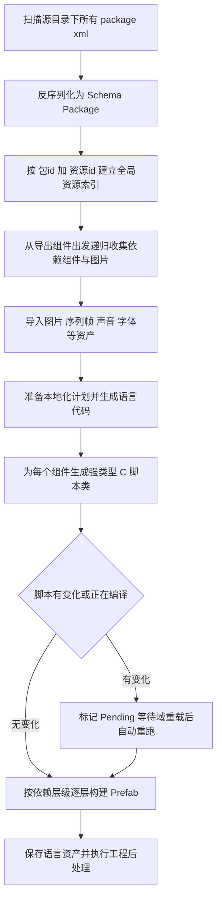

# OpenFairy SDK 的 Editor 侧 FairyGUI 到 UGUI 转换机制调研

- 日期：2026-11-04
- 调研对象：`thirdparties/OpenFairy-SDK-uGUI/Assets/Plugins/OpenFairy/`（下文相对路径均以该目录为根）
- 调研目的：为本项目（FairyGUI XML 静态转 HTML 渲染器）寻找可借鉴的解析与转换设计
- 版权注意：参考仓库无 LICENSE，本文只描述行为与流程，源码引用不超过 3 行，禁止复制源码

---

## 1. 总体转换管线

OpenFairy 的定位是：继续用 FairyGUI Editor 编辑 UI，用 OpenFairy 把 FairyGUI 工程（`UIProject/`）转换成 uGUI prefab + C# 代码。设计取向是 **烘焙优先（bake-first）+ 复用 uGUI 原生**：布局、皮肤、关联、动效结构在转换期烘进 prefab，运行时组件只做薄薄的行为层。

入口是 Unity 菜单 `Tools/OpenFairy/Migrate`，即 `Editor/Migrate.cs` 的 `Execute()`。完整流程如下：

关键步骤说明：

1. **索引（IndexSources / IndexPackage）**：遍历源工程 `assets/` 下所有 `package.xml`，用 `FairyXml.LoadPackage` 反序列化为 `Schema.Package`，以「包 id + 资源 id」为键建立全局 `Resources` 字典。FairyGUI 的 `ui://` 引用本质就是 `ui://<包id><资源id>` 的十六进制拼接，因此 O(1) 解引用。
2. **依赖收集（Collect）**：从所有 `exported` 的组件出发，递归展开 displayList 中的子组件引用、ComboBox 的 dropdown、list 的 defaultItem / item url、滚动条资源，以及对组件 XML 全文做 `ui://` 正则扫描（覆盖 icon 属性、富文本内嵌图等隐蔽引用）。收集过程中计算 `BuildLevel`（依赖深度），保证被依赖的组件先构建。
3. **资产导入**：图片直接拷 PNG 并配置 TextureImporter（Sprite、禁 mipmap、`alphaIsTransparency=false` 以保留透明像素 RGB、不压缩、九宫格写 spriteBorder、tile 图先裁透明边）；`.jta` 序列帧按二进制帧头逐帧合成整幅 PNG；声音拷贝导入；字体分两路：`.fnt` 位图字体解析成 BitmapFont ScriptableObject，`ttf/otf` 作为动态 Font 导入。
4. **本地化准备（PrepareLocalization）**：读 `settings/OpenFairyLocalization.json` 的语言表与各语言 XML 字符串文件，扫描组件中的可本地化文本，生成强类型语言资产代码。
5. **生成脚本（GenerateScript）**：每个组件生成一个 `partial class`（命名空间 = 包名），内嵌控制器枚举、子物体引用字段、动效字段与 Hook 枚举/方法。若脚本内容有变化，则设置 SessionState 标记 `Pending`，等 Unity 域重载后由 `[DidReloadScripts]` 钩子自动重入 `Execute()` 继续构建 prefab——这一步是转换器与 Unity 编译管线的握手。
6. **构建 Prefab（BuildPrefabs）**：按 `BuildLevel` 分层，每层先在内存中 `CreatePrefab` 搭好全部 GameObject 树，再统一 `SaveAsPrefabAsset`。上一层产物进入 `Prefabs` 缓存，供下一层嵌套实例化。
7. **后处理**：保存语言资产，随后反射调用所有标了 `[MigratePostProcess]` 的工程特有收尾方法。

---

## 2. XML 解析层（FairyXml.cs）

### 2.1 解析方式

`FairyXml.cs`（833 行）没有用 `XmlSerializer` 的黑盒行为，而是**自研了一套基于反射的声明式反序列化器**：

- Schema 类型（`Schema.Package`、`Schema.Component`、`Schema.Display` 等）的字段上标注标准 `XmlAttribute` / `XmlElement` / `XmlArray` / `XmlArrayItem` 特性；
- `FairyXml.Read` 按字段特性把 XML 属性/子元素映射到字段，`ChildBinding` 缓存「元素名到类型」的绑定；
- 解析结果全部是强类型 POCO（`OpenFairy.UGUI.Editor.Schema` 命名空间），后续转换器全程面向对象操作，不再碰 XML。

### 2.2 解析出哪些数据结构

| Schema 类 | 来源 XML | 承载内容 |
|---|---|---|
| `Package` | package.xml 根 `packageDescription` | 包 id + `resources` 数组（image / movieclip / sound / component / atlas / font / swf） |
| `Resource` | resources 子项 | id、name、path、scale（整图 / 9grid / tile）、scale9grid、texture、exported 等 |
| `Component` | 每个组件 XML 根 | size、extention（Button/ComboBox/ProgressBar/Slider/Label/ScrollBar 扩展类型）、overflow、mask、scroll 系列、displayList、controllers、relations、transitions、扩展定义节点 |
| `Display` | displayList 的 image/graph/text/richtext/inputtext/loader/group/movieclip/jta/component/list 子项 | 一个 GObject 的全部静态属性：xy、size、pivot、scale、rotation、alpha、visible、touchable、grayed、blend、filter、文本属性、relations、gears、实例级扩展（Button/Label 等） |
| `Controller` | controller 节点 | name、pages（id 与 name 交替的扁平数组解析成元组数组）、homePage 解析逻辑、action 列表 |
| `Gear` | gearXXX 节点 | controller、pages、tween/duration/ease/delay、default、values（竖线分隔多页值） |
| `Extension` | Button/ComboBox 等扩展节点 | title、icon、mode、checked、controller+page（按钮关联控制器）、dropdown、items/values 等 |
| `Transition` / `TransitionItem` | transition 节点 | name、autoPlay 系列、frameRate、item 数组（target、type、time、tween、startValue/endValue/value、path、label） |

### 2.3 发布视图预处理（值得注意的设计）

`LoadPublishedComponentXml` 在解析前先构造「发布视图」：

- `autoClearItems="true"` 的 list/tree/ComboBox 会删除全部 `<item>` 子节点（这是发布指令：预览项不进产物，运行时由 defaultItem 动态 Fill）；
- `autoClearText="true"` 的文本读取为空串。

该视图同时服务于 prefab 构建、资源依赖收集和本地化代码生成三处，保证口径一致；源文件本身不改写。

### 2.4 类型转换与词表折叠

- `Convert` 支持布尔（仅 `true` 为真）、整型/浮点（InvariantCulture）、`Vector2`（逗号对）、四元组颜色滤镜数据、逗号分隔数组、页元组数组（id,name 成对）、关联规则数组；
- `ParseEnum` 三级回退：`XmlEnum` 别名表精确匹配 → `Enum.TryParse` 忽略大小写 → **标点折叠**（`left-left`、`multiple_singleclick` 折叠成 `LeftLeft`、`MultipleSingleClick`）。这一层吸收了 FairyGUI XML 词表的历史杂写（如 `titleType="valueAndmax"`）；
- 空属性值 = 枚举缺省值；`hz`/`vt` 这类缩写有专门映射。

### 2.5 Finish 阶段的语义归一

解析完每个对象后 `Finish` 做归一：

- 元素标签名 → `DisplayKind` / `GearKind` / `ResourceKind` 枚举（`jta` 标签归一为 movieclip）；
- `src + pkg` 归一成 `ui://` 完整引用存入 `Display.Source`；
- `autoSize` 属性按元素类型分流（loader 是布尔，文本是枚举）。

---

## 3. GObject 到 UGUI 的映射策略

`Migrate.CreatePrefab` 负责单个组件的完整构建；`CreateChild` 按 `DisplayKind` 分派。总体原则：**能用 uGUI 原生组件就用原生，只有行为差异大的才造自定义 `UIBehaviour` 子类**。

### 3.1 各 G 类的映射

| FairyGUI 类型 | UGUI 产物 | 说明 |
|---|---|---|
| GImage | `UnityEngine.UI.Image` | 装饰图 `raycastTarget=false`（复刻 FairyGUI TouchDisabled 语义）；type 按 tile→Tiled、有九宫格边框→Sliced、否则 Simple；进度填充映射 Filled 并逐个重排 Origin 枚举；翻转用自定义 Image 子类的 flipX/flipY |
| GGraph（无形状） | 纯 `RectTransform` | 只是占位容器 |
| GGraph（有形状） | 自定义 `Graph`（OnPopulateMesh 自绘） | 矩形/椭圆/多边形/折线/正多边形/圆角矩形，坐标全部烘焙期定死 |
| GTextField / GRichText | 自定义 `TextField`（继承 `UnityEngine.UI.Text`，复刻 FairyGUI 排版公式） | TMP 宏开关下替换为 `TextMeshProUGUI`；描边挂 TextStroke、投影挂原生 Shadow（y 偏移取反）；autoSize 映射 ContentSizeFitter |
| GTextInput | 原生 `InputField` + 透明背景 Image + TextField 作 textComponent + placeholder + InputSubmit 中继 | 刻意不复用自绘 TextField 作输入面（自绘网格不填 cachedTextGenerator，光标定位会失效）——宁造结构也不硬适配 |
| GLoader | 自定义 `Loader` | 内容可为 Sprite / MovieClip / 组件 prefab 实例；运行时零 URL 解析 |
| GMovieClip | 自定义 `MovieClip` | 帧数组 = 逐帧导入的 Sprite，interval/addDelays 来自二进制头 |
| GComponent（自定义组件） | **递归实例化依赖包的 prefab**（`PrefabUtility.InstantiatePrefab`） | 实例级扩展（title/icon/value/controller 覆盖）逐一 Configure；子关系先 `RestoreBaseline` 再 `BeginConstruction(源尺寸)` |
| GList | ListSource（烘焙描述）+ 视口/内容结构 | 见 3.3 |
| GGroup | 子物体 reparent 进组节点 | 高级布局挂 `GroupLayout` + ContentSizeFitter；组级 alpha/显隐走 GearLook/GearDisplay 逐 target 传播（CanvasGroup），不造 runtime group |

### 3.2 坐标、锚点与尺寸转换（SetRect）

FairyGUI 是左上原点、y 向下；uGUI RectTransform 默认中心原点、y 向上。OpenFairy 的约定是**统一把 pivot 和 anchor 基点设为左上 (0,1)**，然后：

- `offsetMin` / `offsetMax` 由「父宽高、xy、size、锚点比例」一步算出（锚点为左上点时等价于简单的 top/left 偏移）；
- 作者写了 pivot 时：新 pivot = (pivot.x, 1 - pivot.y)，pivot 改变会移动锚定参考点，只需补偿「剩余 sizeDelta」部分（`anchoredPosition += delta * sizeDelta` 的向量式补偿）；
- `anchor`（以轴心为锚）语义：xy 先减去 pivot 乘 size；
- rotation 直接映射 `-localEulerAngles.z`（y 轴方向取反）；scale 映射 localScale。

当父容器关联（relation target 为空）且规则**对父尺寸是仿射的**时，`RelationAnchorBaker.TryBake` 直接把它烘焙成原生锚点（anchorMin/anchorMax 拉伸），让 uGUI 布局系统免费获得响应式；不满足仿射条件的才落到 Relation 组件（见第 4 节）。

### 3.3 List / 滚动 / 蒙版的结构烘焙

- **滚动（overflow=scroll）**：`BuildScrollView` 生成「viewport（RectMask2D + 透明 Image）+ content + ScrollPane」三层，滚动条按配置实例化滚动条组件的 prefab 并绑定（ScrollbarDisplay Auto 时用 CanvasGroup 藏起来按需显示）；margin / scrollBarMargin / floating / left 等都换算成 viewport 的 offset 与滚动条的锚点拉伸。
- **List**：先按 overflow 决定是否套滚动结构；`ListSource` 组件烘焙 itemPrefab（defaultItem）、count、layout 枚举、lineGap/colGap、alignment、lineItemCount、renderOrder；预览项逐个实例化成 prefab 实例并按布局算法（单列/单行/横向流/纵向流，pagination 退化按横向流）**绝对定位**；内容总尺寸算出后设置 grip 长度。非虚拟 SingleRow 再由 `ListLayoutBuilder` 追加原生 `HorizontalLayoutGroup` 让行宽跟随子项实际宽度。选择交互由 `ListSelection` 组件承接。
- **蒙版（mask）**：FairyGUI 的蒙版是显示列表里一个形状节点。OpenFairy 的做法是**新建一个专用 Mask 节点**（MaskShape + 原生 Mask，showMaskGraphic=false），把原组件全部子节点 reparent 进去；蒙版形状节点本身保持为内容的**兄弟**而非父节点，控制器继续绑定原始节点。软裁剪（clipSoftness）通过给 RectMask2D 设 softness + 换软裁剪材质实现。

### 3.4 通用外观属性（ApplyElement）

- alpha → `CanvasGroup.alpha`（组级绝对值，避免与 gear/动效通道相乘）；touchable=false → `CanvasGroup.blocksRaycasts=false`；
- blend 模式 → `BlendModeEffect`（换材质）；颜色滤镜 → `ColorAdjust`（容器类用捕获合成 presentation 节点）；
- 置灰（grayed）按 FairyGUI 语义三级回退：按钮有 disabled 页 → 换页；存在名为 grayed 的控制器 → 切其页 1；都没有 → 灰度滤镜（`Grayed`）；
- opaque（组件缺省不穿透点击）→ 根节点补一张全矩形透明 Image 作射线面。

---

## 4. Controller、Gear、Transition、Relations 的转换策略

总原则：**结构静态化（enum + 序列化字段烘进 prefab），行为留运行时薄层驱动**。没有任何「运行时查名称解析 XML」的路径。

### 4.1 Controller

- 每个控制器在生成脚本里变成**组件类内嵌 enum**（页名 → 枚举成员，经命名去重）+ 一个 `Controller<该enum>` 序列化字段；
- `Controller<T>` 是 struct（非 MonoBehaviour），内含 `[SerializeReference]` 的 gears 与 actions 数组；初始页在构建期由 `Bake(初始页)` 直接置位（编辑态 apply 不带动画，运行时才缓动）；
- 控制器动作（change_page / play_transition）烘焙成 `ChangePageAction<T>` / `PlayTransitionAction<T>`，页映射（`~1` 同序号、`~2` 按页名、指定 id）在转换期解析成 int 数组；目标已删除的陈旧引用直接跳过（与 gear 的 DropStalePages 同一套防护）；
- 组件实例的 controller 覆盖（`<component controller="c1,pageId">`）在实例化后调 `SetControllerPage` 应用；
- 按钮关联控制器（`<Button controller page>`，tab/单选组机制）烘焙进 `ButtonBase.relatedOwner/relatedController/relatedPage`，并给控制器补 `GearButton` 使程序化换页也能反向同步按钮选中态。

### 4.2 Gear

每个 gear 节点解析后通过反射实例化 `GearXXX<页enum>`（GearDisplay/GearXY/GearColor/GearLook/GearSize/GearAni/GearFontSize/GearText/GearIcon/GearScrollPage/GearListSelection/GearButton），值数组在转换期全部解析成强类型：

- `values` 以竖线分隔多页值，`-` 槽位 = default 值；gearXY 的值从作者坐标系换算成 anchoredPosition 增量；gearColor 同时解析主色与描边色；gearLook 四元组（alpha,rotation,grayed,touchable）拆到 CanvasGroup 通道并预挂 Grayed；gearSize 兼容老格式「w,h」（无 scale 分量回退 default 的 scale）；
- pages 引用了已删除页 id 时，把该槽连同平行的 values 槽一并剔除（防止切到第 0 页误命中陈旧值）；
- GearDisplay 与 GearDisplay2 结成 partner 对（组合显示条件）；
- 缓动配置（tween/duration/ease/delay）对各类 gear 通用，ease 名（`Expo.Out`）映射 DOTween 枚举；
- 运行时 `Controller<T>.Apply` 复刻 FairyGUI 的 HandleControllerChanged 顺序：非 display gear 先 apply（起 tween 并加 display lock），display gear 后 apply，实现「旧页飞出再消失」。

### 4.3 Transition

- 每个动效在根节点挂一个 `Transition` MonoBehaviour（名字唯一标识），item 全部转换期解析：帧时间按 frameRate 换算成秒；tween 项的 startValue/endValue 按类型解析成 float 数组（Visible/Animation/Color 有专门编码）；非 tween 项的 value 按类型分流（Sound 解引用成 AudioClip 并挂 AudioSource、嵌套动效按名找到同组件的另一个 Transition 实例、Icon 烘成 Sprite）；
- XY 项记录「当前位置 - 设计位置」的偏移量，路径数据直接存 float 数组；
- 动效的 label/label2（Hook 点）生成嵌套 enum 与 `SetXxxHook(label, end, callback)` 方法，业务代码用枚举挂钩而非字符串；
- 不支持的 item type（ParseTransitionType 返回 null）或目标已删除的项直接过滤。

### 4.4 Relations（三级策略）

1. **原生锚点**：父容器关联且规则对父尺寸仿射（单轴最多一条对齐规则 + 一条尺寸规则，无非线性依赖）→ `RelationAnchorBaker` 烘成 anchorMin/anchorMax 拉伸，uGUI 布局系统原生响应容器缩放；
2. **Relation 组件**：兄弟目标、扩展规则（leftext 等 27 种全词表）、顺序相关的百分比规则 → 在 owner 上挂一个 `Relation` 组件，typed bindings（直接对象引用 + 规则枚举 + 百分比标志）序列化进 prefab；
3. **基线记录**：每个 Relation 在构建完成时 `Record()` 记录 owner 与各 target 的几何基线（序列化字段），运行时在 PostLateUpdate 后轮询目标变化、按基线增量重算；嵌套组件实例在实例化时 `RestoreBaseline` 恢复已烘焙基线、再 `BeginConstruction(源尺寸)` 进入构造期，避免子内容伸展被重复累计。

滚动容器有独立的 coordinateSpace（viewport），百分比缩放不含 padding；组、蒙版的 reparent 全程保留作者矩形与参考空间。

---

## 5. 命名与资源策略

### 5.1 命名（Migrate.Names.cs）

目标：**原作者名称不改，生成物内部名字保证可编译、无冲突、稳定**。

- `Identifier`：非法字符折叠成下划线，C# 关键字（含 `checked` 这类与 FairyGUI 页名高概率撞车的词）前加下划线转义；
- `UniqueName`：同一作用域（组件类的全部成员、基类全部成员名、Unity 序列化保留字段、包内类型名集合）内去重，冲突加 `_2` 后缀；重复的作者名只保留首个作为公开字段，其余仍是独立显示对象；
- 组件类名 = `classNamePrefix + 文件名`，同包冲突时追加 `_资源id`；包命名空间按包 id 分组去重；
- `ignoreNoname`（Publish.json 配置）：过滤 `n` + 纯数字的默认名子元件，不为其生成公开字段；
- `PreserveScriptGuid`：生成脚本改名时通过 `AssetDatabase.MoveAsset` 迁移原 `.cs` + `.meta`，保持 prefab 上的脚本 GUID 引用不断。

### 5.2 资源迁移

- **图片**：FairyGUI 发布后的图片本就是独立 PNG（图集只存在于编辑器内部），直接拷贝到输出目录镜像包结构，配置 TextureImporter；tile 图先裁掉透明边（对齐原生图集裁剪相位）；九宫格信息写进 sprite.border；
- **序列帧（.jta）**：自定义二进制格式（帧头 + 每帧偏移/尺寸/图片索引 + 内嵌 PNG 列表）逐帧合成整幅 PNG 导出，帧率/附加延迟存入 MovieClipData；
- **字体**：`.fnt`（BMFont 文本格式或逐字图片格式）解析字形表打包成 BitmapFont 资产（图集跨字号共享）；`ttf/otf` 作为动态 Font 导入（TextCore 栅格化）；默认字体取 `settings/Common.json`，运行时 `TextField.defaultFont` 静态量也在烘焙期固化，通用工程无需胶水；
- **声音**：拷贝导入 AudioClip，按钮点击音来自 Common.json 配置；
- **ui:// 引用**：运行时零残留——所有引用在转换期解成 Unity 直接引用（Sprite/AudioClip/prefab），`TryResolve` 解析不到的陈旧引用留 null 占位不抛异常。

### 5.3 本地化（Migrate.Localization.cs）

- 语言配置在 `settings/OpenFairyLocalization.json`，各语言为 FairyGUI 格式的 XML 字符串表（`FairyTranslations` 只取含 `-` 的组件级 key）；
- 转换期扫描组件中所有可本地化文本（标题、提示、tooltip、list 项、ComboBox 项等），生成强类型代码：每组件一个 `XxxTexts` 可序列化类（StaticTextCode），全局一个语言表 ScriptableObject + Language 枚举（StaticLocaleCode）；
- 文本模板变量（{0} 类占位）生成 `TextTemplate` 与变量枚举；prefab 构建完成后 `BindLocalization` 把文本组件与语言表的引用烘焙好，运行时切语言只是换表对象，零名称查找。

---

## 6. 该转换机制的局限性（设计上明确不做）

来自 README「范围与边界」与 AGENTS.md「发布范围与取舍」：

1. **资源 URL / 动态异步加载不做**：`Loader` 运行时不解析 URL，内容全部在转换期烘成直接引用；
2. **FairyGUI runtime API 签名一致性不做**：能用 Unity 原生（RectMask2D、CanvasGroup、InputField、锚点拉伸、ScrollRect）就不造并列封装；
3. **GList 高级特性不做**：虚拟化、分页吸附、方向键导航、GTree 均超出范围（pagination 布局也退化按横向流排布）；
4. **tooltips 浮层、blur 滤镜、跨组件 Controller page-action 不做**；
5. **小数百分比锚点未映射**（FairyGUI usePercent 的分数位），demo 未用到故记为已知缺口；
6. **文本**：Shrink/Ellipsis 走烘焙的 overflowMode 近似；UBB 裸 `[url]`（无等号）不取 href；富文本运行时内嵌图按出现序号绑定，`ui://` 概念运行时不复存在；
7. **ScrollPane 惯性/回弹常数取近似值**，非逐帧复刻；ScrollToView 仅竖直；
8. **输入框**：restrict/keyboardType/focus-blur 事件/Tab 导航部分缺失；`Draggable.dragBounds` 用 parent-local 而非 GRoot-local（ draggable 本就是运行时 API，交给业务代码）；
9. **Popup/ComboBox 外点关闭用透明 blocker，表现为模态**（规避 Input System 兼容问题的工程取舍）。

---

## 7. 对当前项目（FairyGUI XML 静态转 HTML 渲染器）的可借鉴点

本项目与 OpenFairy 的目标形态不同（HTML/DOM vs Unity prefab），但两者同属「**把 FairyGUI 发布 XML 离线/静态翻译成宿主平台结构**」，以下设计可直接借鉴：

1. **两阶段架构：强类型 Schema + 分类型 Builder**。先解析成强类型对象树（`Schema.Component/Display/Gear/...`），转换逻辑全部面向对象；每个 G 类型一个 Configure 函数（如 ConfigureImage/ConfigureText/ConfigureShape）。HTML 渲染器同样应拆成「解析层产出 Schema」+「DOM 构建层按 Kind 分派」，而不是边解析边拼 DOM。
2. **发布视图预处理**。`autoClearItems` / `autoClearText` 是发布指令而非运行时行为，且必须让布局计算、依赖收集、文本替换三处共用同一份预处理后的视图。渲染器解析 XML 后应先做同一层归一。
3. **坐标换算公式直接可用**。左上原点、y 向下与 CSS 的 top/left 定位天然同构；OpenFairy 的 pivot 补偿公式（新 pivot = (x, 1-y)，anchoredPosition 补偿 = delta * sizeDelta）与 anchor（轴心为锚）的 xy 前置缩减，可以平移成 CSS transform-origin 与 left/top 的换算依据。FairyGUI rotation 为顺时针正方向，HTML rotate 正方向为逆时针，对应 OpenFairy 取 `-rotation` 的做法。
4. **仿射关系 → 原生布局，其余 → 运行时**。RelationAnchorBaker 的「判断规则对父尺寸是否仿射」是 deciding CSS 化的关键模式：父容器关联的简单对齐/拉伸规则可以直接翻译成百分比定位或 flex/grid，兄弟目标与扩展规则才需要 JS 参与计算。这比「全部 JS 手算布局」和「全部 CSS 硬套」都更省力且更稳。
5. **词表折叠 + 别名表的容错解析**。FairyGUI XML 枚举词表存在缩写（hz/vt）、连字符/下划线杂写、大小写不一。渲染器解析层应建同一张「枚举 + XmlEnum 别名 + 标点折叠」的映射，而不是逐个 if。
6. **陈旧引用防护约定**。gear pages 里的陈旧页 id 连同平行 values 槽一起剔除；`ui://` 解引用失败留占位不中断；动效目标已删除的项静默过滤。真实工程的发布包普遍带这类脏数据，渲染器需要同等韧性。
7. **alpha 语义**：alpha 是组级绝对值通道（CanvasGroup），与每子项颜色相乘是错误实现——HTML 里应对应「容器 opacity」而非逐节点调 color；grayed 的三级回退（disabled 页 → grayed 控制器 → 灰度滤镜）同样值得照抄优先级。
8. **列表布局算法可移植**。flow_hz / flow_vt 的换行条件（lineItemCount 优先，否则按视口宽度）、autoItemSize 的单列拉宽/单行拉高、gap 语义（负 gap 允许重叠、零尺寸成员不占 gap）、内容总尺寸计算——这套纯数学逻辑可直接翻译成渲染器的静态排布实现。
9. **滚动结构映射**。viewport（裁剪 + margin）+ content（承载绝对定位子项）+ 滚动条三层结构，正好对应 HTML 的 `overflow` 容器 + 内层绝对定位内容 + 自绘滚动条；viewportSize 扣除 margin 与滚动条内缩的计算公式可复用。
10. **限制清单即渲染器的 MVP 边界参考**。OpenFairy 明确不做的（虚拟化列表、GTree、blur、URL 动态加载、跨组件 page-action）同样是 HTML 静态渲染器可以合理延后的部分；反过来说，OpenFairy 已验证能覆盖官方 Basics/Transition 全部 demo 的特性集，可以作为渲染器第一阶段的完成度标杆。
11. **验证方法论**。OpenFairy 用「golden 参照图 + 交互几何 JSON + parity 测试」证明转换正确性。渲染器可以类比：用 FairyGUI 编辑器截图作 golden，与 HTML 渲染结果做像素 diff（项目 dev-examples 沙盒适合先跑通这一环）。

**不建议照搬的部分**：OpenFairy 大量利用 Unity Editor API（AssetImporter、PrefabUtility、域重载握手、反射构造泛型 gear）完成幂等重导，这些是平台绑定的工程细节；HTML 渲染器是纯静态翻译，只需要它的 Schema 定义、词表、换算公式与映射决策表，不需要其资产管线。

---

## 8. 参考文件路径清单

以下路径均相对仓库根 `thirdparties/OpenFairy-SDK-uGUI/Assets/Plugins/OpenFairy/`：

**Editor 侧（转换器主体）**
- `Editor/Migrate.cs` —— 转换总入口与全部构建逻辑（ Execute/Collect/ImportImage/ImportMovieClip/ImportFont/GenerateScript/CreatePrefab/CreateChild/SetRect/BuildScrollView/BuildList/BuildTransitions/BuildRelations/ConfigureText/ConfigureInput 等）
- `Editor/FairyXml.cs` —— XML 反序列化器与全部 Schema 类型定义（Package/Component/Display/Controller/Gear/Extension/Transition 及枚举词表）
- `Editor/Migrate.Names.cs` —— 生成期命名分配（Identifier/UniqueName/GeneratedMembers/类名与包名去重/TransitionHook 枚举）
- `Editor/Migrate.Publication.cs` —— 按依赖层级分批构建并保存 prefab
- `Editor/Migrate.FilterPresentations.cs` —— 滤镜 presentation 的窄修复工具
- `Editor/Migrate.TextShadows.cs` —— TMP 文字阴影材质窄刷新
- `Editor/Migrate.Localization.cs` —— 本地化计划、生成代码与 prefab 绑定
- `Editor/ListLayoutBuilder.cs` —— 非虚拟单行列表的原生 HorizontalLayoutGroup 烘焙
- `Editor/GroupLayoutBuilder.cs` —— 高级分组布局（GroupLayout + ContentSizeFitter）
- `Editor/RelationAnchorBaker.cs` —— 父容器仿射关系烘焙成原生锚点
- `Editor/ColorFilterBuilder.cs` / `Editor/BlurFilterBuilder.cs` / `Editor/ObjectFilterBuilder.cs` / `Editor/GrayedBuilder.cs` —— 颜色/模糊滤镜与置灰的捕获合成结构
- `Editor/InputEditingBuilder.cs` —— 输入框 Tab 导航与 InputEditing 烘焙
- `Editor/WindowBuilder.cs` —— Window 显隐动效/关闭按钮/拖动区绑定
- `Editor/ExternalFontLifetime.cs` —— 外部字体缓存的生命周期清理
- `Editor/FairyTranslations.cs` / `Editor/StaticTextCode.cs` / `Editor/StaticLocaleCode.cs` / `Editor/TextTemplateCompiler.cs` —— 本地化字符串解析与强类型代码生成
- `Editor/TmpSpriteAssetBuilder.cs` / `Editor/TmpTextMaterialBuilder.cs` / `Editor/MigrationSettings.cs` / `Editor/RenderingSettingsProvider.cs` —— TMP 内嵌图集/材质、工程设置与 Gamma 渲染配置

**Runtime 侧（承接 Editor 产出）**
- `Runtime/Component.cs` —— 组件基类（UIBehaviour，controllerChildren 初始化链与控制器页存取虚方法）
- `Runtime/Controller.cs` —— `Controller<T>` 结构体（页/齿轮/动作的运行时驱动与 display lock 顺序）
- `Runtime/Gear.cs` —— `Gear<T>` 抽象基类（tween/display lock/Apply 协议）
- `Runtime/Relation.cs` + `Runtime/RelationMath.cs` —— 关系组件的基线记录、轮询与几何求解
- `Runtime/Root.cs` / `Runtime/GammaUI.cs` —— 根容器（弹窗/模态层）与 Gamma 渲染开关
- `Runtime/Transition.cs` / `Runtime/ListSource.cs` 等 —— 动效播放与列表填充的运行时面

**文档**
- `README.md` —— 设计取向（烘焙优先/复用原生/静态强类型）、使用流程、范围与边界
- `Documentation~/Relations.md` / `Documentation~/GroupLayout.md` / `Documentation~/import-settings.md` —— 关系、分组布局、导入设置的官方说明
- 仓库根 `AGENTS.md` —— 发布范围与取舍、已知边界、踩坑记录
