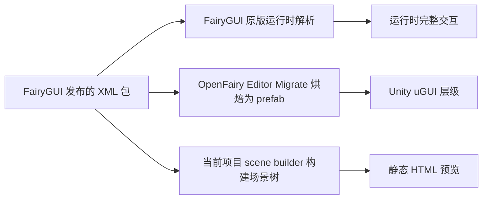

# 总览：当前 HTML 渲染器与 FairyGUI 原版及 OpenFairy UGUI 转换的组件对比

> 日期：2026-11-04
> 本文是系列调研的总览，逐组件详细对比见同目录下各篇文档（文末索引）。

## 一、三套代码的定位

| 代码 | 位置 | 角色 |
|------|------|------|
| FairyGUI 原版 | `thirdparties/OpenFairy-SDK-uGUI/Assets/FairyGUI/Scripts/UI/` | 语义基准：GObject 家族的完整运行时实现（自绘渲染树 + 运行时交互） |
| OpenFairy UGUI 版 | `thirdparties/OpenFairy-SDK-uGUI/Assets/Plugins/OpenFairy/`（Runtime + Editor） | 转换参考：把 FairyGUI 发布的 XML 包烘焙成 Unity prefab + uGUI 组件，"烘焙优先、复用 uGUI 原生" |
| 当前 HTML 渲染器 | `src/renderer/`（入口 `html-renderer.ts`，节点实现 `src/renderer/nodes/`） | 本项目：把 FairyGUI XML 静态渲染成 HTML/CSS，用于设计期预览与截图对比 |

三方关系（转换管线视角）：

## 二、渲染器架构现状（速览）

- 入口 `src/renderer/html-renderer.ts`：`RENDERERS` 注册表按节点类型分发，未注册类型（或节点被标记 unsupported）统一渲染为红色虚线占位框并计入未支持清单。
- 节点实现共 6 个文件（`src/renderer/nodes/`）：`component`、`graph`、`image`、`list`、`loader`、`text`。
- 公共支撑：`utils.ts`（baseStyle 定位/尺寸/翻转等、nineSliceStyle、tintStyle/feColorMatrix、dataAttrs）、`gear.ts`（gear 默认页求值）、`types.ts`。
- 场景构建在 `src/scene/scene-builder.ts`（递归展开组件实例、list item、循环防护、stableKey）。

## 三、已实现组件状态矩阵

状态含义：[完整] 语义基本对齐；[部分] 有明显缺口；[占位] 仅占位不渲染内容；[未实现] 无对应文件。

| 节点类型 | 当前实现文件 | 状态 | 已实现要点 | 主要缺口（详见各篇） |
|----------|--------------|------|-----------|---------------------|
| image | `image-node.ts` | [部分] | img / 九宫格 border-image / 染色 feColorMatrix / grayed / gearColor 覆盖 | fillMethod 填充、染色 8 位色 alpha、aspect 策略 |
| text | `text-node.ts` | [部分] | fontSize / color / 描边（CSS 近似）/ autoSize=height / align / pre-wrap / gearColor 覆盖 | valign、UBB 富文本、模板占位、leading、输入框 prompt |
| graph | `graph-node.ts` | [部分] | rect / ellipse 填充 + gearColor 覆盖 | lineSize 描边、corner 圆角、polygon / regular_polygon、旧拼写 eclipse 归一 |
| component | `component-node.ts` | [部分] | 递归渲染子场景、子节点 absolute、尺寸缺省取子组件设计尺寸、gear 默认页求值 | overflow 裁剪、relations、group 透传、实例 gear 页覆盖、初始页规则对齐 |
| list | `list-node.ts` | [部分] | defaultItem 静态展开（上限 200）、column / row / flow_hz / pagination 布局、colGap / lineGap | 视口裁剪、item 逐项属性下发（title/icon）、flow_vt、滚动 / 选中 / 虚拟化 / 树（静态渲染边界外） |
| loader | `loader-node.ts` | [占位] | 无 url 灰底占位（不计 unsupported） | url 指向包内 image/component 实际可行但未做；外部 url / GLoader3D 建议明确不做 |

各篇文档中的高频共性差距（跨组件）：

1. **overflow:hidden 视口裁剪**：component 与 list 均未裁剪溢出内容，属成本最低、视觉收益最大的一项。
2. **gear 只求默认页**：`gear.ts` 求默认页终态，实例覆盖页、tween 均无（静态渲染定位内的合理简化）。
3. **运行时交互类能力**（Controller action、Transition、Relations 同步、滚动、选中态、换 url）：三方中只有 OpenFairy 用 Runtime 组件承接，当前静态渲染器定位内不实现，需在文档中明确边界。

## 四、未实现组件清单（FairyGUI GObject 家族）

以下类型当前走统一 unsupported 占位（红色虚线框 + 未支持清单上报）：

| FairyGUI 类 | 说明 | OpenFairy UGUI 对应 | 静态 HTML 补齐可行性 |
|--------------|------|---------------------|---------------------|
| GButton | 按钮（关联控制器 + 状态页） | `Button.cs` | 高：多为 component + title/icon 下发，可复用 component 通路 |
| GLabel | 标签（component + text 组合糖） | `Label.cs` | 高：XML 展开后基本是 component/text，常被 parser 间接覆盖 |
| GComboBox | 下拉框 | `ComboBox.cs` | 低：弹层交互为主，静态只宜渲染收起态 |
| GSlider / GProgressBar | 滑条 / 进度条 | `Slider.cs` / `ProgressBar.cs` | 中：静态渲染当前值姿态即可 |
| GMovieClip | 序列帧动画 | `MovieClip.cs` | 低：动画类，静态只能渲染首帧或占位 |
| GRichTextField / GTextInput | 富文本 / 输入框 | TMP / `TextInput.cs` | 低：交互与排版引擎强相关，静态定位内建议占位 |
| GTree | 树形列表 | Runtime List 承接 | 低：虚拟化交互组件 |
| GLoader3D | Spine/DragonBones 3D 容器 | 无直接对应 | 不建议做 |
| GGroup | 分组（布局关联载体） | `GroupLayout.cs` | 中：作为 layout 透传可实现 |
| ScrollPane / Window / DragDrop 等 | 容器机制与窗口系统 | `ScrollPane.cs`(ScrollRect) / `Window.cs` | 交互系统，静态定位内不实现 |

注：GButton/GLabel 在实际发布的 XML 中多以 component 形式存在（导出时已展开），是否需要独立分支以 parser 实测为准。

## 五、OpenFairy 转换机制要点（对本项目的启示）

OpenFairy Editor 以 `Migrate.Execute()` 为总入口，七步管线（索引资源表 → 收集依赖 → 导入资源 → 本地化 → 生成强类型 C# → 构建 prefab → 后处理），核心策略：

- **烘焙优先**：能静态决定的全部烘焙进 prefab，运行时零 `ui://` 解析。
- **复用 uGUI 原生**：仿射父关系烘成原生锚点，其余挂 Relation 组件；Controller 烘成内嵌 enum + 泛型结构体。
- **两阶段转换**：反射式反序列化器产出强类型 Schema，再由各 Builder 生成，职责清晰。

对本项目最可借鉴的三点：Schema+Builder 两阶段结构（对应 parser 与 renderer 分层，现状已一致）、左上 pivot 坐标换算公式、布局词表折叠与列表布局算法（list/grid 换行规则）。详见 `2026-11-04-openfairy-ugui-转换机制.md`。

## 六、补齐优先级建议（综合各篇结论）

1. component/list 的 `overflow:hidden` 视口裁剪 —— 一行级改动，视觉收益最大。
2. loader 的包内 url（image 分支）—— 基础设施（parseUiUrl / expandList / image 渲染路径）全部现成。
3. graph 的 corner 圆角与拼写归一（corner 用 CSS border-radius，eclipse 兼容）。
4. text 的 valign（flex 对齐）与 leading 换算。
5. image 的 fillMethod 填充（进度/冷却类图，可用 CSS linear-gradient 遮罩近似）。
6. list 的 item title/icon 属性下发、flow_vt。
7. GButton/GLabel 独立分支（先以 parser 实测 XML 中出现频率决定是否值得做）。

## 七、系列文档索引

| 文档 | 内容 |
|------|------|
| `2026-11-04-image-组件三方对比.md` | GImage vs OpenFairy Image vs image-node（九宫格/染色/填充差距） |
| `2026-11-04-graph-组件三方对比.md` | GGraph vs Graph.cs vs graph-node（形状类型全集与静默退化问题） |
| `2026-11-04-text-组件三方对比.md` | GTextField 家族 vs TMP 双后端 vs text-node（UBB/模板/描边近似性） |
| `2026-11-04-list-组件三方对比.md` | GList vs ListSource/VirtualListLayout vs list-node（虚拟化与静态边界） |
| `2026-11-04-loader-组件三方对比.md` | GLoader vs Loader.cs vs loader-node（url 解析可行性分析） |
| `2026-11-04-component-组件三方对比.md` | GComponent 体系 vs Component/Relation vs component-node（容器基座全对比） |
| `2026-11-04-openfairy-ugui-转换机制.md` | OpenFairy Editor 的 XML→UGUI 七步管线与借鉴点 |

## 八、参考文件路径

- 当前实现：`src/renderer/html-renderer.ts`、`src/renderer/nodes/*.ts`、`src/renderer/gear.ts`、`src/renderer/utils.ts`、`src/scene/scene-builder.ts`
- FairyGUI 原版：`thirdparties/OpenFairy-SDK-uGUI/Assets/FairyGUI/Scripts/UI/`（GObject 家族）
- OpenFairy Runtime：`thirdparties/OpenFairy-SDK-uGUI/Assets/Plugins/OpenFairy/Runtime/`
- OpenFairy Editor：`thirdparties/OpenFairy-SDK-uGUI/Assets/Plugins/OpenFairy/Editor/`
- 注意：该 SDK 仓库无 LICENSE，以上文档仅描述其解析行为与格式知识，未复制源码。
